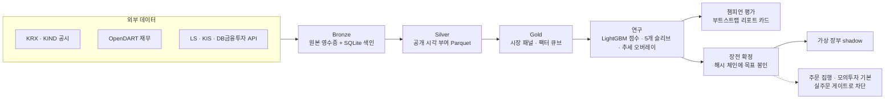

# K-Stock Engine

**국내 주식(KRX) 다중 팩터 투자 전략을 연구하고, 매일 장 시작 전에 목표 포트폴리오를 만들어 가상 장부로 기록하는 프로젝트**

[](./pyproject.toml) [](./src/research/model.py) [](./src/data/) [](./.github/workflows/deploy.yml)

> [!NOTE]
> 서버에서는 데이터 수집, 장전 목표 포트폴리오 확정, 가상 장부(shadow) 기록까지 자동으로 돌며 **실제 주문은 내지 않습니다**. 주문 집행 코드는 모의투자(paper)가 기본이고, 실주문은 안전 조건을 모두 채우기 전까지 코드에서 막혀 있습니다.

## 🧭 개요

개인이 국내 주식 투자 전략을 만들 때 부딪히는 문제는 전략 자체보다 **믿을 수 있는 검증**입니다.

- 재무제표는 분기말이 아니라 **공시된 시각**부터 알 수 있는 정보인데, 이를 무시하면 백테스트에 미래 정보가 섞입니다.
- 거래비용, 세금, 결제일(T+2)을 소수점 계산으로 대충 처리하면 백테스트와 실제 계좌가 어긋납니다.
- 증권사 API는 호출 한도가 있고, 같은 서버의 여러 프로젝트가 한 계정을 함께 씁니다.
- 전략을 계속 바꿔 보면 과거 데이터에만 맞는 결과(과적합)를 고르게 됩니다.

K-Stock Engine은 이 네 가지를 구조로 막는 것을 목표로 합니다. 데이터 수집, 백테스트, 전략 비교, 매일의 목표 포트폴리오 확정, 서버 운영·점검까지 한 저장소에 있습니다. 소스 약 5만 4천 줄, 테스트 약 8만 3천 줄입니다(Python 파일 줄 수 기준).

## 🏗️ 시스템 구성



저장소는 계층 순서가 정해진 패키지로 나뉩니다. 아래 계층은 위 계층을 가져다 쓸 수 없고, 이 규칙은 [AST 검사 테스트](./tests/unit/core/test_package_dependency_boundaries.py)가 모든 import를 읽어 확인합니다.

```text
core → config → integrations → data → backtest → research → ops
                  execution (core만 참조, 조립 지점에서만 다른 계층 연결)
```

서버에서는 systemd 타이머가 정해진 시각에 Docker 컨테이너로 작업을 실행합니다(시각은 KST, [유닛 파일](./deploy/systemd/)).

| 시각 | 작업 | 하는 일 |
| :--- | :--- | :--- |
| 평일 08:32 | morning | 전일 데이터 확정, 목표 포트폴리오 봉인, 가상 장부 갱신 |
| 평일 08:39 | auction-open | 장전 동시호가 호가 수집 |
| 평일 18:30 / 20:40 | collect-eve / collect-dbsec | 수급·공시·재무 수집 / 시세 보조 수집 |
| 평일 21:40, 주말 12:00 | daily-audit | 당일 작업 결과 점검 |
| 매일 02:30 | backup | 원격 저장소(Google Drive) 백업 |
| 토 10:30 | weekly-report | 주간 운영 리포트 |

## 🔧 핵심 설계 결정

각 결정을 **문제 → 분석(대안 비교) → 선택 → 결과** 순서로 정리했습니다.

### ⏱️ 1. 공시 시각 기준으로 데이터를 쓰는 이유

- **문제:** 분기 재무제표는 분기말 기준 값이지만 실제로는 최대 45일 뒤에 공시됩니다. 분기말 날짜로 합치면 백테스트가 그 시점에는 몰랐던 정보를 씁니다.
- **분석:** 분기말 날짜에 며칠 지연을 두는 방법은 간단하지만, 종목마다 공시 시점이 달라 지연 값을 일률로 정할 수 없습니다. 실제 접수 시각을 알면 지연 가정이 필요 없습니다.
- **선택:** 수집물마다 받은 시각을 영수증([ReceiptCatalog](./src/data/receipt_catalog.py))으로 남기고, 정규화 단계에서 접수 시각 다음 거래일 장 시작을 `available_at`으로 계산합니다([normalization.py](./src/data/normalization.py)). 연구와 평가는 `available_at` 이전 데이터만 봅니다. 데이터 계약은 [pit.py](./src/core/pit.py)에 있습니다.
- ✅ **결과:** 모든 데이터가 "언제부터 알 수 있었는지"를 갖습니다. 이 규칙은 단위 테스트로 검증합니다.

### 🧮 2. 정수 원 단위 회계 장부

- **문제:** 부동소수점으로 현금과 수량을 계산하면 오차가 쌓이고, 결제일(T+2)과 증거금을 빼먹으면 백테스트가 실제 계좌보다 낙관적이 됩니다.
- **분석:** 허용 오차를 두고 비교하는 방법은 오차가 어디서 생겼는지 추적하기 어렵습니다. 모든 금액을 정수 원으로 두면 장부가 맞는지 정확히 비교할 수 있습니다.
- **선택:** 현금(CASH)·증거금(MARGIN)·미결제(PAYABLE) 3개 계정과 거래 종류별 분개를 가진 장부([ledger.py](./src/backtest/ledger.py))에서 주식, 선물, 인버스 ETF, 배당, 세금을 함께 처리합니다. 주문 집행에서는 매도 주문을 매수보다 먼저 제출해([submit_intents.py](./src/execution/application/submit_intents.py)) 결제 자금이 부족해지는 일을 줄입니다.
- ✅ **결과:** 백테스트와 가상 장부가 같은 장부 코드를 씁니다([ledger_bridge.py](./src/research/ledger_bridge.py)). 장부 불변식은 단위 테스트로 검증합니다.

### 🚦 3. 증권사 호출 한도를 서버 전체에서 공유

- **문제:** 한 서버의 여러 프로젝트가 같은 KIS 계정을 씁니다. 프로세스 안에서만 속도를 제한하면 서로의 호출량을 몰라 한도를 넘고, 토큰 발급도 동시에 겹칩니다.
- **분석:** 프로세스 안 제한기는 구현이 쉽지만 다른 프로세스를 보지 못합니다. 별도 중앙 서버는 운영 부담이 큽니다.
- **선택:** 공유 디렉터리의 파일 락(`flock`)에 다음 호출 가능 시각을 기록하는 [HostPacedLimiter](./src/integrations/kis/admission.py)를 만들었습니다. 초당 18건을 넘지 않게 슬롯을 예약하고, 우선순위 3단계(critical은 즉시, standard는 최대 1.0초, bulk는 최대 0.25초까지만 앞당겨 예약)로 중요한 호출을 보호합니다. 토큰은 키 해시별 락으로 한 번만 발급하고, 기다리는 동안 다른 프로세스가 받은 토큰을 재사용합니다.
- ✅ **결과:** 한도와 토큰 처리를 테스트로 검증합니다. 공유 디렉터리 표식이 없으면 실행을 거부해, 제한이 공유되지 않은 채 돌아가는 상황을 막습니다.

### 📊 4. 전략 평가: 단일 Sharpe 대신 부트스트랩 리포트 카드

- **문제:** 전략을 계속 바꿔 보면 점수 하나로는 과적합을 구분하기 어렵습니다. 주 1회 리밸런싱은 매매 요일에 따라 성과가 달라지기도 합니다.
- **분석:** 평균 수익이 아니라 나쁜 경우의 성장률을 목적 값으로 삼고, 매매일은 분산하기로 했습니다.
- **선택:** 주식 자금을 5개 슬리브로 나눠 매매 요일을 분산하고([book.py](./src/research/book.py)), KOSPI 200 이동평균 추세에 따라 선물 포지션을 얹는 오버레이([trend_overlay.py](./src/research/trend_overlay.py))를 결합했습니다. 평가([evaluation.py](./src/research/evaluation.py))는 63거래일 블록 부트스트랩 4,000회로 5년 경로를 만들어 하위 10% 성장률을 목적 값으로 쓰고, 파산 확률 가드와 슬리피지 비용 격자(0, 0.5, 1.0, 1.5틱)를 함께 봅니다([protocol.toml](./config/research/protocol.toml)). 새 전략이 챔피언이 되려면 같은 구간에서 짝지은 부트스트랩 비교와 다중 검정 보정을 통과해야 합니다([champion.py](./src/research/champion.py)). 점수 모델은 시드 11·12·13 평균을 써서 시드 운을 줄입니다([three_seeds.toml](./config/research/challenge/three_seeds.toml)).
- ✅ **결과:** 전략 변경이 "더 좋아 보인다"가 아니라 정해진 통계 기준으로 승격됩니다. 기준 값에 대한 근거는 설정 파일 주석에 남깁니다.

### 🔒 5. 실주문을 코드 단계에서 막는 안전 게이트

- **문제:** 자동매매는 버그 하나가 곧바로 돈 문제가 됩니다.
- **분석:** 설정 한 줄로 켜지는 방식은 실수로 켜지기 쉽습니다. 검증 증거를 요구하는 방식이 더 안전합니다.
- **선택:** 주문 집행은 헥사고날 구조(포트·어댑터)로 나누고, [SubmissionGate](./src/execution/application/readiness.py)가 실주문 요청에 네 가지 증거(증권사 대사, 주문 상태 전이, 모의투자 통과, 중복 주문 방지)를 모두 요구합니다. 하나라도 없으면 예외를 냅니다. 같은 멱등성 키의 주문은 두 번 처리하지 않습니다. 실행 설정의 기본 모드는 `paper`입니다([settings.py](./src/execution/settings.py)).
- ✅ **결과:** 서버는 장전 호가 수집과 가상 장부 기록만 하고 주문을 내지 않습니다.

### 🛠️ 6. 무인 운영: 작업 결과 4상태 기록과 점검

- **문제:** 자동 작업이 "성공"이라고 기록해도 실제 데이터가 비었거나 일부만 쓰인 경우가 있습니다.
- **분석:** 예외가 없으면 성공으로 보는 방식은 부분 실패를 놓칩니다.
- **선택:** 모든 작업은 `OK / DEGRADED / NO_DECISION / SKIPPED` 중 하나로 결과를 기록하고([run_outcome.py](./src/ops/run_outcome.py)), 일일 감사([audit.py](./src/ops/audit.py))가 기록과 산출물을 대조합니다. 장 시작 전까지 목표를 확정하지 못하면 늦게 확정해도 `OK`가 아니라 `DEGRADED`로 남깁니다.
- ✅ **결과:** 실패 알림은 원인 한 줄 요약 메일로 보내고, 같은 원인은 24시간 동안 중복 발송하지 않습니다([alerts.py](./src/ops/alerts.py)).

## 📊 결과

> [!IMPORTANT]
> **원본 실행 결과 파일이 저장소에 포함되어 있지 않아 아래 수치는 이 저장소만으로 재현해 확인할 수 없습니다.** 결과를 만든 설정은 [`three_seeds.toml`](./config/research/challenge/three_seeds.toml)과 [`protocol.toml`](./config/research/protocol.toml)입니다.

| 항목 | 값 | 기준 |
| :--- | :---: | :--- |
| 평가 구간 | 2018-01 ~ 2026-10 | 백테스트(워크포워드), 비용·세금 반영 |
| 연복리 수익률(CAGR) | +49.43% | 백테스트 |
| Sharpe / 최대 낙폭 | 1.50 / -23.47% | 백테스트 |

백테스트 수익률은 실제 계좌 수익이 아닙니다. 이 프로젝트는 실주문을 내지 않습니다.

## ⚠️ 한계

- 위 성과는 **백테스트 값**입니다. 실계좌 운용 기록이 없습니다.
- 결과 파일이 저장소에 없어, 외부에서 같은 수치를 재현하려면 데이터를 직접 수집해야 합니다. 수집에는 증권사·OpenDART 계정이 필요합니다.
- 점수 모델을 8년 넘는 구간에서 여러 번 조정했기 때문에, 부트스트랩 기준을 써도 과적합 가능성이 완전히 사라지지는 않습니다.
- 실주문 경로는 증권사 대사·상태 전이 증거가 없어 막혀 있고, 실제 체결과 백테스트 가정(슬리피지, 시장 충격)의 차이는 검증하지 못했습니다.
- 단일 개발자, 단일 서버 운영이며 서버 이중화는 없습니다.

## 🧱 기술 스택

| 구분 | 사용 기술 |
| :--- | :--- |
| 언어·도구 | Python 3.11, uv(잠금 파일로 환경 고정), ruff, mypy |
| 데이터 | Polars, PyArrow(Parquet), SQLite, pandas, numpy, numba |
| 모델 | LightGBM(5·10·21일 앞 수익률 예측, 52개 팩터), scikit-learn |
| 연동 | KRX, KIND, OpenDART, LS증권, 한국투자증권(KIS), DB금융투자, aiohttp, pydantic |
| 배포·운영 | Docker, GitHub Actions(테스트 후 이미지 빌드·서버 배포), systemd 타이머, rclone |
| 테스트 | pytest(테스트 함수 약 3,300개, 정적 집계), 변경분 커버리지 검사 [verify.py](./tools/verify.py) |

## 📂 프로젝트 구조

```text
src/
├── core/          # 시간, KRX 달력, 호가 규칙, 공개 시각(PIT) 계약. 다른 패키지에 의존하지 않음
├── config/        # 공급자 정책, 런타임 설정, 데이터 신선도 기준
├── integrations/  # KRX·KIND·OpenDART·LS·KIS·DB금융투자 클라이언트, 호출 한도 제어, 쿼터 기록
├── data/          # Bronze 영수증 카탈로그, Silver 변환, 시장 패널, 백업
├── backtest/      # 정수 장부, 거래비용, 시장 배열, 체결 엔진
├── research/      # 팩터 큐브, LightGBM 점수, 슬리브 북, 추세 오버레이, 평가, 챔피언, shadow
├── ops/           # systemd 작업, 결과 4상태 기록, 일일 감사, 알림
└── execution/     # 주문 계획·검증·제출, 모의/증권사 어댑터, 실주문 게이트
config/            # 공급자, 런타임, 전략·평가 프로토콜
deploy/            # systemd 유닛, 컨테이너 실행 래퍼, 설치 스크립트
tests/             # 단위·통합 테스트
tools/             # verify.py 통합 검사
docs/              # 증권사 API 정리
legacy/            # 이전 세대 코드(참고용, 린트 대상에서 제외)
```

## 🚀 시작하기

Python 3.11과 [uv](https://docs.astral.sh/uv/)가 필요합니다. 데이터 수집에는 각 증권사·OpenDART API 키가 필요하며, 키는 저장소에 포함되어 있지 않습니다.

```bash
uv sync
uv run ruff check src tests
uv run mypy src
uv run pytest
uv run python tools/verify.py      # 린트·타입·테스트·변경분 커버리지

# 연구
uv run python -m src.research build-cube
uv run python -m src.research evaluate --spec config/research/challenge/three_seeds.toml

# 데이터
uv run python -m src.data.cli collect-krx-daily-market
uv run python -m src.data.cli build-market-panel

# 주문 집행 (모의투자 기본)
uv run python -m src.execution auction-open
uv run python -m src.execution rehearse

# 운영 작업
uv run python -m src.ops.jobs audit
```

증권사별 API 특성과 한도는 [브로커 API 종합 명세](./docs/architecture/brokers/api_master.md)와 같은 폴더의 문서에 정리했습니다.

## 🤖 개발 과정에서의 AI 활용

AI 코딩 도구를 코드 작성에 주로 사용했고, 아이디어 정리와 금융 도메인 학습에도 활용했습니다. **수치와 동작은 직접 검증했습니다.**

| AI에 맡긴 일 | 직접 한 일 |
| :--- | :--- |
| 코드 작성 | 전략·검증 방식과 구조 결정 |
| 아이디어 정리, 도메인 개념 학습 보조 | 결과 수치와 동작 확인 |

## 📚 참고

- 증권사·공급자 연동 명세: [`docs/architecture/brokers/`](./docs/architecture/brokers/)
