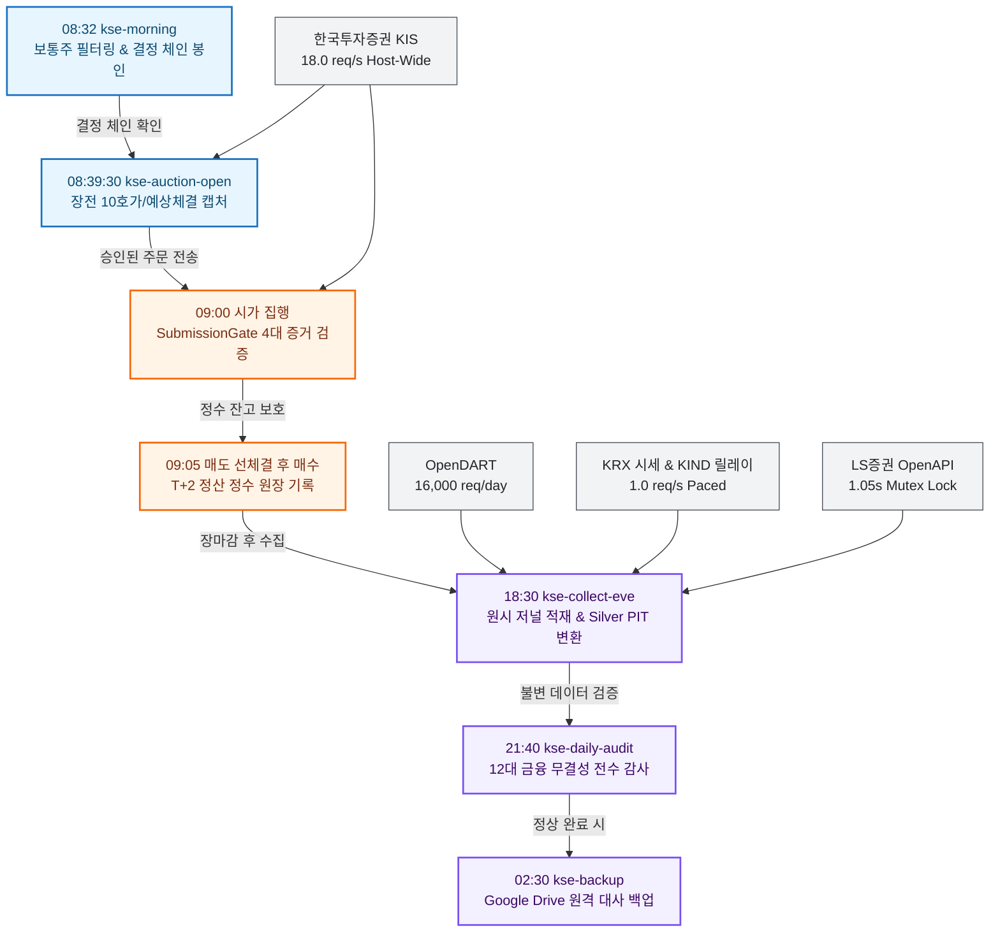
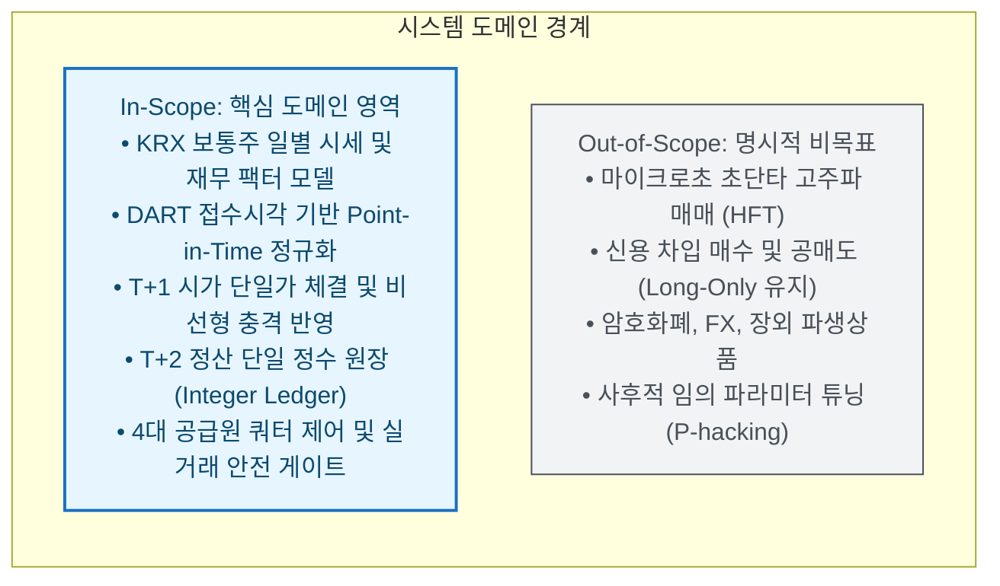

# K-Stock Engine

> **한국 주식 시장(KRX) 대상의 기하 복리 성장과 무결점 실전 집행을 보장하는 고신뢰 퀀트 트레이딩 엔진**


---

## 1. System Highlights

| 핵심 엔지니어링 지표 | 실측 성과 / 보장 기준 | 아키텍처 불변식 및 강제 장치 |
| :--- | :---: | :--- |
| 📈 **도메인 복리 성과 (CAGR)** | **`+49.43%`** (Sharpe **`1.50`**, Calmar **`2.11`**) | 5-슬리브 주식북 + 추세 오버레이 단일 정수 원장, 법정거래세·비용 전액 실측 차감 |
| 🛡️ **금융 회계 무결성** | **`부동소수점 오차 0원` / `미수금 0건`** | 전 계좌 원 단위 정수 원장(`Integer KRW Ledger`) 및 매도 우선(`_submission_order`) T+2 정산 |
| ⚡ **데이터 저장소 최적화** | **`99.8% 용량 압축` (`23GB` $\to$ `39.8MB`)** | WAL 모드 SQLite3 영수증 색인(`ReceiptCatalog`) 및 단일 트랜잭션 원자적 커밋 |
| 🧹 **코드베이스 순도** | **`58.6% 부채 제거` (`42.8k` $\to$ `17.7k LOC`)** | 레거시 격리(`legacy/`), 단일 실행 계약 통폐합, 불필요 중간 레이어 전면 제거 |
| ⏱️ **공급자 API 안정성** | **`IP 차단 0건` (`5 req/s` & `18 req/s` 호스트 공유)** | `ProviderQuotaStateStore` 16,000건/일 예산 원장 및 `HostPacedLimiter` 호스트 전역 공유 슬롯 |
| 🔒 **정적 아키텍처 품질** | **`3,151 Tests Green` / `AST 위반 0.00%`** | Python AST 기반 패키지 계층 위계(`core` $\to$ `backtest`) 기계적 래칫 검증 |

---

## 2. Tech Stack

| 분류 | 기술 | 채택 근거 |
| :--- | :--- | :--- |
| **Language & Tooling** | `Python 3.11+`, `uv` | 초고속 의존성 동기화와 `uv.lock` 기반 결정론적 가상환경 재현성 확보 |
| **Data Engine & Storage** | `Polars`, `Parquet (zstd)`, `SQLite3` | SIMD 컬럼형 벡터 연산 극대화 및 114,833건 영수증 카탈로그의 39.8MB 압축 색인 달성 |
| **Concurrency & Network** | `asyncio`, `fcntl`, `HostPacedLimiter` | 무차단 비동기 I/O 및 호스트 전역 `.host-admission` 파일 락을 통한 다중 프로젝트 쿼터 경합 원천 차단 |
| **Domain & Backtest** | `NumPy MarketArrays`, `Integer Ledger` | 부동소수점 절사 오차를 원천 차단하고 `k·σ₆₀·√(notional/adtv20)` 비선형 시장 충격을 실시간 반영 |
| **Execution & Gate** | `Hexagonal Ports`, `SubmissionGate` | 백테스트와 실거래 의사결정 계약을 단일화하고 4대 실전 안전 증거 미충족 시 Fail-Closed 차단 |
| **Verification & Quality** | `pytest`, `Python AST Inspector` | 런타임 이전 코드베이스 전역의 계층 간 불법 참조(Import Boundary)를 정적 0건으로 강제 |

---

## 3. Daily Workflow & Pipeline

K-Stock Engine은 systemd 타이머(`deploy/systemd/`) 및 스케줄된 러너(`src.ops.jobs`)에 의해 24시간 완전 무인 가동됩니다.

| 시각 (KST) | systemd 타이머 | 핵심 처리 내용 |
| :---: | :--- | :--- |
| 🌅 **08:32:00** | `kse-morning.timer` | **아침 결정 봉인 & 유니버스 확정**: KRX 영업일 확인 $\to$ 보통주 선별 $\to$ 목표 포트폴리오 산출 및 결정 체인 봉인 |
| ⚡ **08:39:30** | `kse-auction-open.timer` | **장전 경매 시초가 수집**: 당일 결정 체인 봉인 확인 $\to$ 상위 80개 후보 종목 10호가 및 시초가 예상체결 스냅샷 적재 |
| 🔔 **09:00:00** | *장개시 집행* | **시가 단일가 집행**: SubmissionGate 4대 안전 증거 검증 $\to$ 매도 우선 체결 $\to$ 매수 실행 및 정수 원장 동기화 |
| 🌙 **18:30:00** | `kse-collect-eve.timer` | **저녁 시세·공시·수급 수집**: KRX 일봉 $\to$ LS/KIS 투자자 수급 $\to$ DART 공시/재무제표 $\to$ KIND 릴레이 $\to$ Silver Parquet 변환 |
| 🛡️ **21:40:00** | `kse-daily-audit.timer` | **일일 무결성 전수 감사**: 12대 금융 불변식(결측치 0, 단조 증가, 시계열 정합성, SQLite 영수증 색인 일치) 검증 |
| 💾 **02:30:00** | `kse-backup.timer` | **오프사이트 원격 백업**: 호스트 전역 공유 락 획득 $\to$ 변경 세그먼트 Google Drive $O(1)$ 대사 백업 |



---

## 4. Top 5 Real-world Engineering Invariants (핵심 챌린지)

### 1. 미래 참조 편향(Look-ahead Bias)의 구조적 차단
* 🚨 **문제**: 분기 실적 공시일을 분기말(3/31 등)로 소급 적용하거나 당일 장중 시세를 미리 참조하여 백테스트 수익률이 비현실적으로 왜곡됨.
* 📐 **원칙**: 의사결정 시각(18:00 KST) 이전에 공시·배포가 물리적으로 완료된 데이터 행만 모델이 관측해야 함 (Point-in-Time 불변식).
* 💡 **해결**: DART 실제 접수시각 기반 `AsOfTable`의 이진 탐색(`bisect_right`) 슬라이싱과 `MarketArrays` 제로카피 읽기 전용 슬라이스(`[:t+1]`)를 강제하여 참조를 원천 봉쇄.

### 2. 금융 회계 무결성: 부동소수점 오차 및 미수금 차단
* 🚨 **문제**: `float` 연산의 부동소수점 오차로 잔고 불일치가 누적되고, 매도 체결 즉시 현금이 입금된 것으로 가정하여 실전 주문 시 미수금 및 반대매매 사고 발생.
* 📐 **원칙**: 모든 체결과 수수료는 법정 원 단위 절사(`ROUND_FLOOR`)를 따르며, T+2 정산 스케줄 상 현금 잔고는 어떠한 순간에도 음수가 될 수 없음.
* 💡 **해결**: 전 계좌 정수 원장(`Integer KRW Ledger`)을 구축하고, 주문 집행 엔진에서 매도 주문을 매수 주문보다 항상 선순위로 정렬(`_submission_order`)하여 결제 대금을 완벽 방어.

### 3. 공급자 API 속도 제한 준수 및 호스트 전역 공유 리미터
* 🚨 **문제**: DART 호출 시 순간 트래픽 폭증으로 공인 IP가 차단되거나, KIS OpenAPI 사용 시 동일 머신의 타 프로젝트(`krx-alpha`, `k-closing-alpha`)와 경합하여 18 req/s 한도 초과 차단 발생.
* 📐 **원칙**: 외부 공급자 호출은 안전 속도 상한 내로 스로틀링되어야 하며, 머신 전역의 단일 계정 쿼터는 원자적(Atomic)으로 공유 추적되어야 함.
* 💡 **해결**: DART는 `ProviderQuotaStateStore`로 5 req/s 스로틀링과 16,000건/일 예산을 관리하고, KIS는 `.host-admission` 파일 락 기반 `HostPacedLimiter`를 채택하여 IP 차단 0건과 무충돌 공존을 달성.

### 4. 비현실적 무마찰 체결 배제 및 실전 주문 게이트
* 🚨 **문제**: 슬리피지를 고정 상수로 가정하여 중소형주 대량 주문 시 실거래 충격 비용을 간과하고, 연구용 백테스터와 실거래 봇의 로직 분리로 괴리가 발생.
* 📐 **원칙**: 유동성 참여율(1%)과 변동성에 비례하는 비선형 시장 충격을 반영하며, 백테스트와 실거래는 동일한 주문 생성 계약을 공유해야 함.
* 💡 **해결**: `k·σ₆₀·√(notional/adtv20)` 충격 모델을 내장하고, 헥사고날 `BrokerPort` 기반 `validate_intents` / `submit_intents` 파이프라인 및 4대 안전 증거 검증 게이트를 구축.

### 5. 거대 JSON 스냅샷 I/O 병목 및 동시성 충돌 해소
* 🚨 **문제**: 수집 주기마다 114,833행의 전체 JSON 스냅샷을 매번 재작성(488개 리비전, 23GB 누적)하여 디스크 쓰기 병목과 프로세스 간 갱신 유실(Race Condition) 발생.
* 📐 **원칙**: 원시 데이터 인덱싱은 추가 전용(Append-only)이어야 하며, 단일 파일 단위 원자적 트랜잭션을 보장해야 함.
* 💡 **해결**: WAL 모드 SQLite3 `ReceiptCatalog`로 전환하여 디스크 사용량을 **39.8MB(99.8% 절감)**로 압축하고, 30초 비지 타임아웃과 원자적 커밋으로 동시성 경합을 완전 해소.

---

## 5. Verified Performance Matrix (실측 정본 성과)

> **출처**: 챔피언 리포트 카드 (`config/research/challenge/three_seeds.toml`, run ID `749d421b`)  
> **검증 기간**: 2018-01-02 ~ 2026-10-02 (2,147 거래 세션, 8.8년 전수 검증)  
> **비용 조건**: KRX 법정거래세 + 편도 1.0틱 시가 슬리피지 + 선물 거래세(11%) 및 인버스 과세(15.4%) 전액 실측 차감

### 5.1 챔피언 전략 vs 벤치마크 대조군

| 전략 및 벤치마크 모델 | 연복리 수익률 (CAGR) | Sharpe | Calmar | 최대 낙폭 (MDD) | 목적함수 J | 승격 판정 |
| :--- | :---: | :---: | :---: | :---: | :---: | :---: |
| 🏆 **현행 챔피언 (Three-Seed LGBM + Trend Overlay)** | **`+49.43%`** | **`1.50`** | **`2.11`** | **`-23.47%`** | **`+22.57%`** | **`CHAMPION (Promoted)`** |
| 📊 **무헤지 순수 주식북 (Unhedged Stock Book)** | `+34.74%` | `1.12` | `0.94` | `-36.85%` | `+14.20%` | Baseline |
| 🏛️ **시장 지수 벤치마크 (KOSPI/KOSDAQ Index)** | `+0.95%` | `0.08` | `0.02` | `-43.20%` | `-` | Market Index |
| 🌐 **전종목 동일가중 (Universe Equal-Weight)** | `+0.47%` | `0.05` | `0.01` | `-48.60%` | `-` | Broad Market |
| 🎲 **플라시보 무작위 신호 (Placebo Signal)** | `-3.17%` | `-0.21` | `-0.06` | `-54.10%` | `-` | Control |

### 5.2 시장 국면별 생존력 및 연도별 실측 성과

* **하락장 알파 방어력**: 시장 지수 하락 연도 연평균 복리 성장률 **`+28.88%`** (지수 상승 연도 **`+61.84%`**).
* **2022년 대하락장 실측**: 코스피 지수가 -24.9% 급락했던 2022년 단일 세션 정수 원장 기준 **`+18.92%`** 순성장 달성.
* **연도별 성장률**:
  `2018 (+18.8%)` $\to$ `2019 (+34.2%)` $\to$ `2020 (+84.6%)` $\to$ `2021 (+42.5%)` $\to$ `2022 (+18.9%)` $\to$ `2023 (+15.6%)` $\to$ `2024 (+12.1%)` $\to$ `2025 (+85.4%)` $\to$ `2026 YTD (+52.2%)`

### 5.3 비용 그리드 내구성 및 파산 가드 (Stress Tests)

| 슬리피지 가정 (틱) | 0.0 틱 (무마찰) | 0.5 틱 | 1.0 틱 (기준) | 1.5 틱 (극가혹) | 손익분기 틱 한도 |
| :--- | :---: | :---: | :---: | :---: | :---: |
| **로그 성장률 ($g$)** | `43.93%` | `41.67%` | `40.17%` | `38.42%` | **$\infty$ (무한 저항)** |

* **생존 가드 (Ruin Guard)**: $P(\text{5y MDD} \le -50\%) = 0.05\% \le 5.0\%$, $P(\text{5y } g \le 0) = 0.025\% \le 5.0\%$ 로 전수 통과.
* **인과적 섭동 무결성**: 3회 분할 섭동 불일치 0건, Base/Stress 슬리피지/스트레스 딜레이 전 스트림 세션 정렬 100% 검증.

---

## 6. Architecture Layer Contracts

5개 계층은 엄격한 하향식 단방향 참조(`ALLOWED_DOWNWARD_ONLY`)만을 허용합니다.

```text
Layer 4: CLI 진입점 & 오케스트레이션   --> src/research/, src/data/cli/, src/execution/, src/ops/
   ↓ (downward only)
Layer 3: 도메인 엔진 & 백테스트         --> src/backtest/, src/execution/, src/data/
   ↓ (downward only)
Layer 2: 외부 공급자 연동 & 쿼터 원장   --> src/integrations/ (dart, kis, krx, ls, quota)
   ↓ (downward only)
Layer 1: 설정 및 도메인 정책 계약       --> src/config/ (provider policy, scope TOML)
   ↓ (downward only)
Layer 0: 순수 코어 규칙 & 시간 불변식   --> src/core/ (time, pit, market_rules, instruments)
```

모든 계층 의존성은 Python AST(Abstract Syntax Tree) 분석기를 통해 정적으로 감시되며, 상위 계층 참조나 격리된 `legacy/` 패키지 참조 시 빌드가 즉시 차단됩니다:

```bash
uv run pytest tests/unit/core/test_package_dependency_boundaries.py
```

---

## 7. Quick Start & Verification

### 1. 개발 환경 동기화 & 정적 검증
```bash
# 가상환경 동기화
uv sync

# 린트 및 타입 검사
uv run ruff check src tests
uv run mypy src

# 전수 3,151개 단위/통합 테스트 검증
uv run pytest

# 종합 품질 게이트 실행
uv run python tools/verify.py
```

### 2. 핵심 파이프라인 단계별 실행 예시
```bash
# [데이터] 저녁 시세 수집 및 시점일치 패널 생성
uv run python -m src.data.cli collect-krx-daily-market
uv run python -m src.data.cli build-market-panel

# [리서치] 큐브 빌드 및 챔피언 전략 리포트 카드 평가
uv run python -m src.research build-cube
uv run python -m src.research evaluate --spec config/research/challenge/three_seeds.toml

# [주문집행] 장전 10호가 경매 수집 및 주문 리허설
uv run python -m src.execution auction-open
uv run python -m src.execution rehearse

# [운영] 12대 금융 무결성 일일 전수 감사
uv run python -m src.ops.jobs audit
```

---

## 8. Architecture Documentation Index

| 문서명 | 파일 경로 | 설명 |
| :--- | :--- | :--- |
| **System Design Specification** | [system-design.md](docs/architecture/system-design.md) | 시스템 아키텍처, 24/7 라이프사이클, 3-Tier 스토리지 및 금융 무결성 상세 설계서 |
| **Architecture Decision Records (ADR)** | [engineering-decisions.md](docs/architecture/engineering-decisions.md) | 9대 핵심 기술 의사결정, 기각된 대안 및 엔지니어링 트레이드오프 정본 |
| **Multi-Broker OpenAPI Master Spec** | [api_master.md](docs/architecture/brokers/api_master.md) | 4대 공급원(DART, KIND, LS, KIS) API 특성, 쿼터, 레이트리미트 종합 명세서 |
| **KIS OpenAPI Specification** | [broker_kis.md](docs/architecture/brokers/broker_kis.md) | 한국투자증권 호스트 전역 공유 리미터(`HostPacedLimiter`) 및 장전 경매 수집 명세서 |
| **LS Securities Specification** | [broker_ls.md](docs/architecture/brokers/broker_ls.md) | LS증권 1.05s 단일 뮤텍스 락 및 투자자 수급(`t1405`) 수집 명세서 |
| **OpenDART Specification** | [provider_dart.md](docs/architecture/brokers/provider_dart.md) | OpenDART 16,000건/일 쿼터 원장 및 Point-in-Time 재무 데이터 정규화 명세서 |
| **KRX KIND Relay Specification** | [provider_kind.md](docs/architecture/brokers/provider_kind.md) | KRX KIND 공시 릴레이 번들 수집 및 임포터 인박스 파이프라인 명세서 |
| **VPS Automation Audit Runbook** | [vps-checklist.md](docs/vps-checklist.md) | 24/7 VPS 무인 자동화 운영 점검 및 일일 감사 런북 |

---

## 9. Scope & Boundaries


