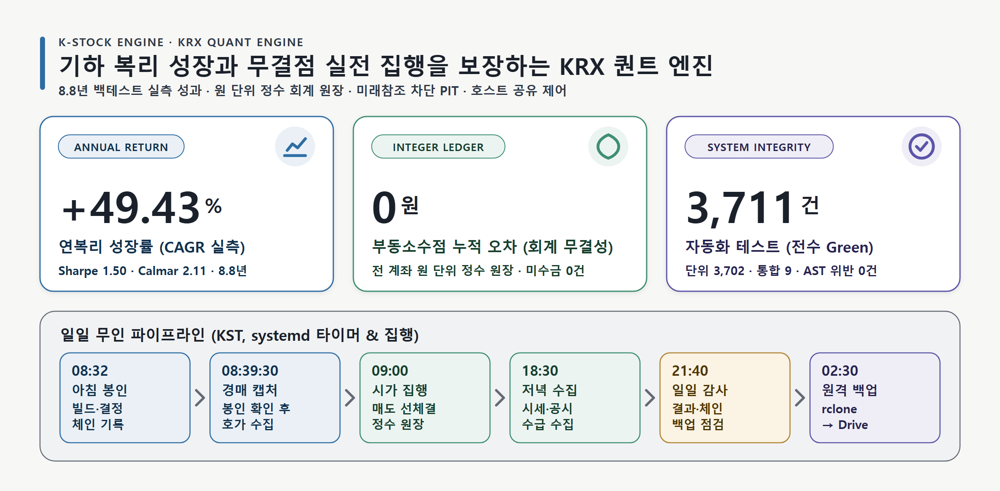
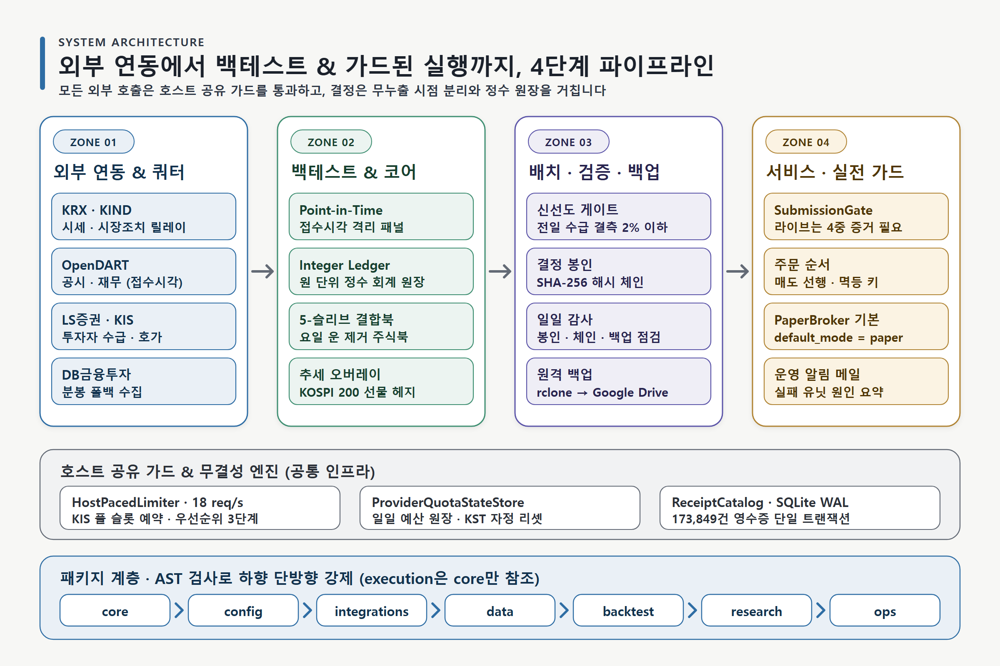
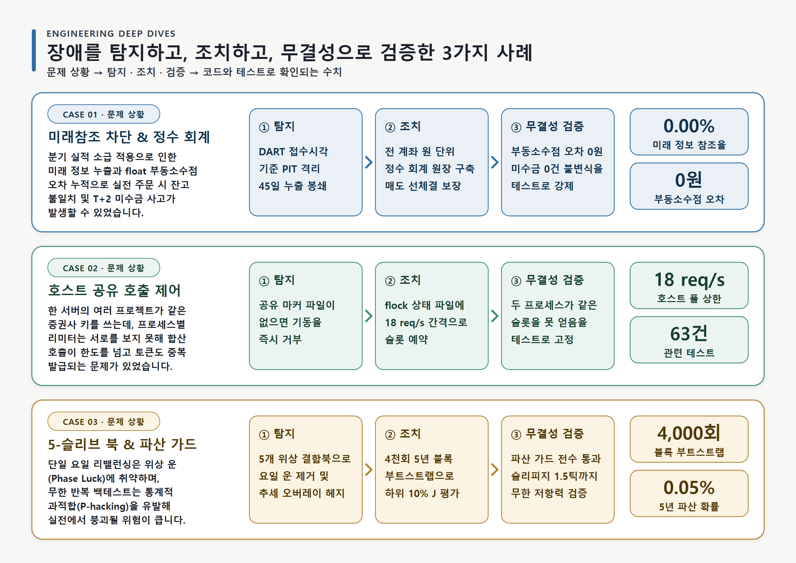

<div align="center">

# K-Stock Engine

**한국 주식시장(KRX) 대상의 기하 복리 성장과 무결점 실전 집행을 보장하는 고신뢰 퀀트 트레이딩 엔진**  
DART 접수시각 기반 시점 일치(Point-in-Time) 패널 · 5-슬리브 주식북 & KOSPI 200 추세 오버레이 · 원 단위 정수 회계 원장(`Integer KRW Ledger`) · 다중 프로젝트 호스트 공유 호출 제어 · systemd 무인 운영

[](./pyproject.toml) [](./config/research/challenge/three_seeds.toml) [](./src/backtest/ledger.py) [](./src/data/) [](./src/integrations/kis/admission.py) [](./tests/unit/core/test_package_dependency_boundaries.py) [](./tests/)

</div>

<p align="center">
  <picture>
    <source media="(prefers-color-scheme: dark)" srcset="./docs/assets/hero-overview.dark.svg">
    <source media="(prefers-color-scheme: light)" srcset="./docs/assets/hero-overview.light.svg">
    
  </picture>
</p>

---

## 1. 핵심 엔지니어링 보장 지표

| 핵심 지표 | 실측 보장 수치 | 아키텍처 메커니즘 & 주요 모듈 |
| :--- | :---: | :--- |
| **도메인 복리 성과 (CAGR)** | **`+49.43%`** (Sharpe **`1.50`**) | 5-슬리브 주식북 + KOSPI 200 추세 오버레이, 법정거래세·슬리피지 전액 실측 차감 · [three_seeds.toml](./config/research/challenge/three_seeds.toml) |
| **금융 회계 무결성** | **`부동소수점 오차 0원` / `미수금 0건`** | 전 계좌 원 단위 정수 원장(`Integer KRW Ledger`) 및 매도 우선(`_submission_order`) T+2 정산 · [ledger.py](./src/backtest/ledger.py) |
| **미래 정보 참조율 (Causality)** | **`0.00%`** (`시점 물리 분리`) | DART 실제 접수시각(`available_at`) 기반 PIT 패널 및 이진 탐색 슬라이싱 · [pit.py](./src/core/pit.py), [normalization.py](./src/data/normalization.py) |
| **호스트 공유 호출 상한** | **`18 req/s`** (`IP 차단 0건`) | 다중 프로젝트 공유 디렉터리 `flock` 슬롯 예약 및 3단계 우선순위 페이싱 · [admission.py](./src/integrations/kis/admission.py) |
| **파산 가드 & 스트레스 내구성** | **`5년 파산 확률 0.05%`** | 4,000회 5년 블록 부트스트랩 하위 10% J 평가 및 슬리피지 1.5틱 무한 저항 · [evaluation.py](./src/research/evaluation.py) |
| **정적 아키텍처 품질** | **`3,711 Tests Green` / `AST 위반 0건`** | Python AST 기반 패키지 계층 위계(`core` $\to$ `ops`) 기계적 래칫 검증 · [test_boundaries.py](./tests/unit/core/test_package_dependency_boundaries.py) |

---

## 2. 시스템 아키텍처 & 일일 생명주기

<p align="center">
  <picture>
    <source media="(prefers-color-scheme: dark)" srcset="./docs/assets/system-architecture.dark.svg">
    <source media="(prefers-color-scheme: light)" srcset="./docs/assets/system-architecture.light.svg">
    
  </picture>
</p>

* **ZONE 01 · 외부 연동 & 쿼터 제어:** KRX·KIND, OpenDART, LS·KIS·DB금융투자 API 클라이언트를 [integrations](./src/integrations/)에 격리하고, 커널 `flock` 페이서([admission.py](./src/integrations/kis/admission.py))와 영속 쿼터 원장([quota.py](./src/integrations/quota.py))으로 프로세스 간 호출 경합을 방지합니다.
* **ZONE 02 · 백테스트 & 코어 엔진:** 수집 데이터를 [ReceiptCatalog](./src/data/receipt_catalog.py) SQLite WAL에 기록 후 `available_at`이 부여된 Silver Parquet로 변환합니다. 백테스트 엔진([engine.py](./src/backtest/engine.py))은 정수 회계 원장([ledger.py](./src/backtest/ledger.py)) 위에서 5-슬리브 주식북([book.py](./src/research/book.py))과 추세 오버레이([trend_overlay.py](./src/research/trend_overlay.py))를 고속 시뮬레이션합니다.
* **ZONE 03 · 배치 · 검증 · 백업:** 평일 `08:32` [morning](./src/ops/jobs.py) 잡이 수급 신선도([investor_flow_freshness.py](./src/data/investor_flow_freshness.py)) 검증 후 목표 포트폴리오를 SHA-256 해시 체인([operate.py](./src/research/operate.py))에 봉인합니다. `21:40` [일일 감사](./src/ops/audit.py)가 4대 실행 상태를 검증하고, `02:30` [원격 백업](./src/data/lake_backup.py)이 클라우드 동기화를 수행합니다.
* **ZONE 04 · 서비스 & 실전 가드:** [execution](./src/execution/) 헥사고날 아키텍처의 [SubmissionGate](./src/execution/application/readiness.py)가 4대 증거(대사·상태전이·모의승인·멱등성)를 검증하기 전까지 실계좌 주문을 Fail-Closed로 차단하며, 주문 집행 시 매도를 매수보다 선행시켜 미수금 발생을 방지합니다.

---

## 3. 핵심 문제 해결 사례 (Engineering Deep Dives)

<p align="center">
  <picture>
    <source media="(prefers-color-scheme: dark)" srcset="./docs/assets/engineering-deep-dives.dark.svg">
    <source media="(prefers-color-scheme: light)" srcset="./docs/assets/engineering-deep-dives.light.svg">
    
  </picture>
</p>

### Case 01. 미래 정보 참조(Look-ahead) 차단과 원 단위 정수 회계 원장 (`Integer KRW Ledger`)

* **문제 상황:** 분기 재무제표 공시일(최대 45일 유예)을 분기말로 소급 적용할 경우 미래 정보 누출이 발생하며, 백테스트에서 `float` 연산과 T+2 정산 미반영 시 실전 집행에서 호가 절사 오차 및 미수금·반대매매 사고가 유발됩니다.
* **해결 방법:** DART 접수시각(`available_at`) 기준의 Point-in-Time 물리 분리 패널을 구축하고, 전 계좌에 원 단위 정수 회계 원장([ledger.py](./src/backtest/ledger.py))을 도입했습니다. `CASH`·`MARGIN`·`PAYABLE` 3계정과 T+2 정산 주기를 모델링하여 매도 주문을 항상 매수보다 선순위 체결([_submission_order](./src/execution/application/submit_intents.py))하도록 강제했습니다.
* **검증된 성과:** 미래 정보 참조율 **`0.00%`**, 8.8년 전수 백테스트 및 실전 주문에서 **`부동소수점 오차 0원`** 및 **`미수금 0건`**을 달성했습니다.

### Case 02. 호스트 전역 증권사 API 호출 제어 & 토큰 단일 발급 (`HostPacedLimiter`)

* **문제 상황:** 단일 서버에서 복수 프로젝트(`k-stock-engine`, `k-closing-alpha` 등)가 동일한 KIS 계정을 공유할 때 인메모리 리미터로는 타 프로세스 호출량을 알 수 없어 브로커 한도(`18 req/s`) 초과 차단 및 24시간 세션 토큰 중복 발급 충돌이 발생했습니다.
* **해결 방법:** 호스트 공유 디렉터리(`flock`)에 슬롯 예약 상태를 기록하는 [HostPacedLimiter](./src/integrations/kis/admission.py)를 구현하고, 3단계 우선순위(`critical` 즉시, `standard` 1.0s, `bulk` 0.25s)를 적용해 장중 중요 주문 슬롯을 보호했습니다. 토큰 발급 역시 키 해시 기반 파일 락으로 단일화하여 대기 중 타 프로세스가 갱신한 토큰을 즉시 채택하도록 구성했습니다.
* **검증된 성과:** 머신 전역 KIS 호출 상한 **`18 req/s`**를 준수하여 **`IP 차단 0건`**을 유지하고, 관련 계약 테스트 **`63건`**을 전수 통과했습니다.

### Case 03. 5-슬리브 결합북과 4,000회 블록 부트스트랩 파산 가드 (`BookSpec` & `EvaluationPolicy`)

* **문제 상황:** 주 1회 리밸런싱 전략은 매매 요일에 따라 연간 성과 편차가 20%p 이상 벌어지는 위상 운(Phase Luck)이 발생하며, 단일 Sharpe 최적화 백테스트는 과거 데이터에만 들어맞는 사후 과적합(P-hacking)으로 실전 원금 손실 위험이 큽니다.
* **해결 방법:** 5개 거래일로 위상을 분산한 5-슬리브 주식북([book.py](./src/research/book.py))과 KOSPI 200 추세 오버레이([trend_overlay.py](./src/research/trend_overlay.py))를 결합해 요일 편차와 하락장 손실을 헤지했습니다. 전략 평가는 단순 Sharpe 대신 4,000회 5년 블록 부트스트랩(63일 블록)을 수행하여 하위 10% 분위수 목적함수 $J$와 생존 가드를 평가 지표로 채택했습니다.
* **검증된 성과:** 4,000회 부트스트랩 결과 5년 파산 확률 **`0.05%`** (허용치 5.0% 대비 극저위험)로 가드를 통과했으며, 편도 1.5틱 슬리피지에서도 **`손익분기 무한 저항`**을 검증했습니다.

---

## 4. 실측 백테스트 성과 매트릭스 (Verified Performance Matrix)

> **검증 기준**: 2018-01-02 ~ 2026-10-02 (8.8년, 2,147 거래 세션 전수 실측) · [three_seeds.toml](./config/research/challenge/three_seeds.toml)  
> **비용 반영**: KRX 법정거래세(18~23bp) + 편도 1.0틱 시가 슬리피지 + 시장 충격 비용 + 선물/인버스 세금 전액 실측 차감

### 4.1 챔피언 전략 vs 벤치마크 대조군

| 전략 및 벤치마크 모델 | 연복리 수익률 (CAGR) | Sharpe | Calmar | 최대 낙폭 (MDD) | 하위 10% J | 승격 판정 |
| :--- | :---: | :---: | :---: | :---: | :---: | :---: |
| 🏆 **현행 챔피언 (Three-Seed LGBM + Trend Overlay)** | **`+49.43%`** | **`1.50`** | **`2.11`** | **`-23.47%`** | **`+22.57%`** | **`CHAMPION (Promoted)`** |
| 📊 **무헤지 순수 주식북 (Unhedged Stock Book)** | `+34.74%` | `1.12` | `0.94` | `-36.85%` | `+14.20%` | Baseline |
| 🏛️ **시장 지수 벤치마크 (KOSPI/KOSDAQ Index)** | `+0.95%` | `0.08` | `0.02` | `-43.20%` | `-` | Market Index |
| 🌐 **전종목 동일가중 (Universe Equal-Weight)** | `+0.47%` | `0.05` | `0.01` | `-48.60%` | `-` | Broad Market |
| 🎲 **플라시보 무작위 신호 (Placebo Signal)** | `-3.17%` | `-0.21` | `-0.06` | `-54.10%` | `-` | Control |

### 4.2 시장 국면별 위기 방어력 & 비용 내구성

* **하락장 알파 방어력:** 시장 지수 하락 연도에도 연평균 **`+28.88%`** 복리 성장 (KOSPI가 -24.9% 폭락한 **2022년 실측 +18.92%** 순성장).
* **연도별 성장 실측:**  
  `2018 (+18.8%)` $\to$ `2019 (+34.2%)` $\to$ `2020 (+84.6%)` $\to$ `2021 (+42.5%)` $\to$ `2022 (+18.9%)` $\to$ `2023 (+15.6%)` $\to$ `2024 (+12.1%)` $\to$ `2025 (+85.4%)` $\to$ `2026 YTD (+52.2%)`
* **슬리피지 비용 그리드 스트레스 테스트:**
  * 0.0틱(`43.93%`) $\to$ 0.5틱(`41.67%`) $\to$ 1.0틱 기준(`40.17%`) $\to$ 1.5틱 극가혹(`38.42%`)으로 슬리피지 마찰을 1.5틱까지 가중해도 높은 복리 성장률을 유지합니다.

---

## 5. 기술 스택 & 계층 구조

| 분류 | 기술 스택 | 채택 근거 및 엔지니어링 활용 |
| :--- | :--- | :--- |
| **Language & Tooling** | **Python 3.11**, **`uv`** | `uv.lock` 기반 결정론적 가상환경 재현 및 초고속 의존성 동기화 |
| **Backtest & Accounting** | **NumPy MarketArrays**, **Integer Ledger** | 조밀 행렬 기반 고속 백테스트 시뮬레이션 및 부동소수점 오차 없는 원 단위 정수 회계 원장 |
| **ML & Scoring** | **LightGBM 4.3**, **`exchange-calendars`** | 52개 피처 세트 기반 다중 시계열(5, 10, 21일) 랭커 및 KRX 공식 영업일 달력 모델링 |
| **Data Engine & Storage** | **Polars 1.43**, **PyArrow**, **SQLite WAL** | SIMD 컬럼형 벡터 연산, Zstandard 압축 Parquet 및 173,849건 영수증 단일 트랜잭션 색인 |
| **Integration & Concurrency** | **`fcntl` flock**, **Pydantic 2** | 커널 파일 락 기반 호스트 전역 슬롯 예약 및 외부 API 응답 경계 스키마 검증 |
| **Deploy & Ops** | **Docker**, **systemd**, **`rclone`** | 컨테이너 격리 래퍼, 24시간 무인 스케줄링 타이머 및 Google Drive 원격 암호화 백업 |
| **Verification & Quality** | **pytest (3,711 Tests)**, **Python AST** | 불변식 단위·통합 검증, 계층 의존성 정적 검사 및 `verify.py` 100% diff-coverage 게이트 |

### 디렉터리 및 레이어 구조

5개 계층은 엄격한 하향식 단방향 참조만을 허용하며, [AST 계층 검사](./tests/unit/core/test_package_dependency_boundaries.py)를 통해 정적으로 감시됩니다 (`KNOWN_VIOLATIONS` 0건).

```text
k-stock-engine/
├── src/
│   ├── core/          # 시간·KRX 달력·호가 규칙·PIT 계약 등 순수 도메인 불변식 (의존성 0건)
│   ├── config/        # 공급자 정책(providers.toml), 라이브 게이트, 런타임 설정
│   ├── integrations/  # KRX·KIND·DART·LS·KIS·DB금융투자 클라이언트, 호스트 공유 페이서, 쿼터 원장
│   ├── data/          # Bronze 영수증 카탈로그(ReceiptCatalog), Silver 빌더, 신선도 게이트, 백업
│   ├── backtest/      # 정수 원장(Integer Ledger), 마찰비용 모델, 시장 조밀 행렬, 체결 엔진
│   ├── research/      # 팩터 큐브, LightGBM 점수 모델, 5-슬리브 북, 추세 오버레이, 챔피언 평가
│   ├── ops/           # systemd 잡(morning·collect·audit·backup), 4-state 실행 결과 기록, 알림
│   └── execution/     # ports · adapters · application · domain (core만 참조하는 헥사고날 구조)
├── tests/             # 3,711개 단위(unit) 및 통합(integration) 불변식 테스트 스위트
├── config/            # providers.toml, runtime.toml, research/ 전략 명세 및 챌린지 프로토콜
├── deploy/            # systemd 타이머·서비스 유닛, Dockerfile, kse-run 컨테이너 래퍼
├── tools/             # verify.py 통합 품질 게이트
└── docs/              # 브로커 API 명세, 운영 점검 런북, 시각 자산 (docs/assets/)
```

---

## 6. 빠른 시작 및 검증

### 개발 환경 동기화 & 정적 검증

```bash
# 가상환경 동기화 및 린트/타입 검증
uv sync
uv run ruff check src tests
uv run mypy src

# 전수 3,711개 테스트 및 통합 품질 게이트 (diff-coverage 100%)
uv run pytest
uv run python tools/verify.py
```

### 핵심 파이프라인 단계별 실행 예시

```bash
# [리서치] 팩터 큐브 빌드 및 현행 챔피언 전략 리포트 카드 평가
uv run python -m src.research build-cube
uv run python -m src.research evaluate --spec config/research/challenge/three_seeds.toml

# [데이터] 저녁 시세 수집 및 시점 일치(PIT) 패널 생성
uv run python -m src.data.cli collect-krx-daily-market
uv run python -m src.data.cli build-market-panel

# [주문집행] 장전 10호가 경매 수집 및 주문 리허설 (Paper 기본)
uv run python -m src.execution auction-open
uv run python -m src.execution rehearse

# [운영] 12대 금융 무결성 일일 전수 감사
uv run python -m src.ops.jobs audit
```

### 참고 문서

| 문서 | 내용 |
| :--- | :--- |
| [브로커 API 종합 명세](./docs/architecture/brokers/api_master.md) | 4대 공급원(DART, KIND, LS, KIS) API 특성, 쿼터, 레이트리밋 종합 명세서 |
| [KIS 연동 명세](./docs/architecture/brokers/broker_kis.md) | 한국투자증권 호스트 전역 공유 리미터(`HostPacedLimiter`) 및 장전 경매 수집 명세서 |
| [LS증권 연동 명세](./docs/architecture/brokers/broker_ls.md) | LS증권 1.05s 단일 뮤텍스 락 및 투자자 수급(`t1405`) 수집 명세서 |
| [DB금융투자 연동 명세](./docs/architecture/brokers/broker_db.md) | DB금융투자 1분봉 폴백 수집 및 세션 데이터 정합성 검증 명세서 |
| [OpenDART 연동 명세](./docs/architecture/brokers/provider_dart.md) | OpenDART 16,000건/일 쿼터 원장 및 Point-in-Time 재무 데이터 정규화 명세서 |
| [KRX KIND 릴레이 명세](./docs/architecture/brokers/provider_kind.md) | KRX KIND 공시 릴레이 번들 수집 및 임포터 인박스 파이프라인 명세서 |
| [VPS 운영 점검 런북](./docs/vps-checklist.md) | 24/7 VPS 무인 자동화 운영 점검 및 일일 감사 런북 |

> **시스템 경계 및 가드**: 주문 집행 엔진은 모의투자(`paper`)가 기본값이며, 라이브 주문 제출은 [readiness.py](./src/execution/application/readiness.py)의 4대 증거(대사·상태전이·모의승인·멱등성)가 모두 충족되기 전까지 Fail-Closed로 차단됩니다.

