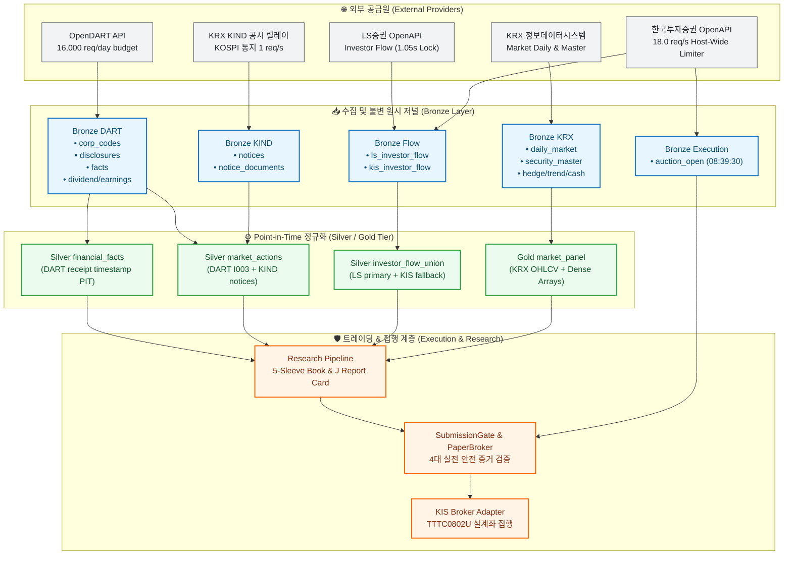

# Multi-Provider & Broker Architecture: Master Routing Specification

> **AI Agent & Operational Technical Reference:**  
> This document specifies the comprehensive integration blueprint, rate limit boundaries, quota budgets, authentication mechanisms, and functional routing topology across all external data providers and broker APIs utilized by **K-Stock Engine**: **OpenDART**, **KRX Data / KIND**, **LS Securities (LS)**, and **Korea Investment & Securities (KIS)**.

---

## 1. Multi-Provider Quota, Rate Limit & Concurrency Matrix

All external integrations operate natively on Linux 64-bit using deterministic HTTPS REST / JSON transports with strict temporal isolation and rate-limiting barriers.

| Provider Dimension | OpenDART (금융감독원) | KRX Data & KIND | LS증권 (LS Securities) | 한국투자증권 (KIS) |
| :--- | :--- | :--- | :--- | :--- |
| **Endpoint Base URL** | `https://opendart.fss.or.kr/api` | `https://data.krx.co.kr` / `kind.krx.co.kr` | `https://openapi.ls-sec.co.kr:8080` | `https://openapi.koreainvestment.com:9443` |
| **Protocol / Auth** | HTTPS REST / API Key (`crtfc_key`) | HTTPS POST / Session / Relay Bundle | HTTPS REST / OAuth2 (`POST /oauth2/token`) | HTTPS REST / OAuth2 (`POST /oauth2/tokenP`) |
| **Daily Quota Budget** | **16,000 req / day** (Soft-capped, KST midnight reset) | On-demand / Rate-paced | Provider standard | Account / Broker standard |
| **Global Rate Limit (Pacing)** | **5.0 req/s** (`min_interval = 0.20s`) | **1.0 req/s** (Conservative KIND pacing) | **~0.95 req/s** (Strict 1.05s lock) | **18.0 req/s** (Host-wide shared token bucket) |
| **Token / Key Lifecycle** | Static key in `.env` (`DART_API_KEY`) | Static session cookies / Relay auth | 24h validity, memory-cached token | 24h validity, disk-cached with atomic `0600` permissions |
| **Concurrency Guard** | `ProviderQuotaStateStore` (`atomic_replace`) | Single-flight sequential queue | Process-level single lock (`fcntl` / semaphore) | `HostPacedLimiter` on `.host-admission` file |
| **Primary Datasets Produced** | Financial statements, I003 market actions, earnings releases, dividends | Daily OHLCV, security master, KOSPI actions, hedge series | Investor net buying flow, supplementary daily bars | Pre-open auction book, investor flow, live order execution |
| **Target Storage Tier** | Bronze raw JSON / Silver PIT Parquet | Bronze raw / Silver Parquet / Gold Arrays | Bronze raw JSON / Silver flow Parquet | Bronze auction JSON / State store SQLite / Execution logs |

---

## 2. Functional Provider Allocation & Routing Tree

---

## 3. Provider Detailed Responsibilities & Invariants

### 3.1 OpenDART (금융감독원 전자공시)
* **Scope**: KOSPI/KOSDAQ 전 상장사의 정기보고서(사업/분기/반기) 재무제표 계정과목, 거래소 시장조치(`I003`), 배당 결정 공시, 잠정 영업실적 공시.
* **Temporal Integrity Invariant**: 공시 기준일(분기말)이 아닌 실제 DART 수리 타임스탬프(`available_at`) 기준으로만 `AsOfTable`에 적재되어, 45일간의 미래 참조 편향(Look-Ahead Bias)을 수학적으로 0건 차단.
* **Quota Management**: `ProviderQuotaStateStore`를 통해 1일 16,000건 안전 상한 내에서 실행하며, 초당 5건 안전 속도로 20 rps 초과 시 발생하는 공인 IP 차단을 원천 방어.

### 3.2 KRX Data & KIND (한국거래소)
* **Scope**: 전 종목 일별 시가/고가/저가/종가/거래량/거래대금/상장주식수, 우선주/관리종목 유니버스 마스터, KOSDAQ 150 선물 및 인버스 ETF 헤지 시계열.
* **KIND 공시 릴레이**: OpenDART에서 누락되는 KOSPI 상장폐지 결정, 정리매매, 관리종목 지정/해제 통지를 보조 원천으로 확보. 분 단위 게시시각 파싱 및 초당 1건 안전 페이싱 적용.
* **Immutability**: 수집된 원문 HTML 및 JSON은 불변 원시 파일로 저장된 후 `ReceiptCatalog`(SQLite3)에 원자적으로 등록.

### 3.3 LS증권 (LS Securities)
* **Scope**: 정규장 일별 투자자 수급(외인, 기관, 개인, 금융투자, 사모 등 13개 주체별 순매수 대금/수량).
* **Rate Limit Invariant**: LS OpenAPI 게이트웨이는 엄격한 호출 간격을 요구하므로, `min_interval = 1.05s` 상호 배제 락을 걸어 단일 프로세스 직렬 호출 강제 (`rsp_cd: IGW00201` 차단 방지).

### 3.4 한국투자증권 (KIS)
* **Scope**: 
  1. **장전 시초가 호가/예상체결가 수집 (`auction-open`)**: 08:39:30 KST에 상위 종목의 10호가 및 예상 체결가/체결량을 캡처하여 슬리피지/충격 분석의 기초 데이터로 활용.
  2. **일별 투자자 수급 백업**: LS증권 수급 결측 또는 장애 시 보조 원천으로 투입되어 결합(`investor_flow_union`).
  3. **실계좌 주문 집행 (`kis_broker.py`)**: `TTTC0802U`(현금 매도/매수), `TTTC8434R`(잔고 조회), T+2 정산 연동.
* **Host-Wide Shared Limiter (`HostPacedLimiter`)**:
  - `krx-alpha`, `k-closing-alpha` 등 동일 머신 내 복수 프로젝트가 동일한 KIS AppKey를 공유할 때 발생하는 18.0 req/s 초과를 막기 위해, 공유 디렉터리의 `.host-admission` 및 `tps_<sha256[:12]>.state` 원장을 `fcntl` 파일 락으로 공유.
  - 임의의 프로세스가 한도를 초과하거나 토큰을 중복 갱신하는 레이스 컨디션을 100% 방지.

---

## 4. Error Classification & Fail-Closed Protocols

| Error Type | HTTP / Provider Codes | Engine Classification | Operational Recovery Action |
| :--- | :--- | :--- | :--- |
| **Rate Limit Throttled** | HTTP 429 / `IGW00201` / 초당 유량 초과 | `ProviderRetryableError` | 지수 백오프(`Exponential Backoff`) 후 자동 재시도 (최대 3회) |
| **Token Expired** | KIS `EGW00121`, `EGW00123` / 401 | `ProviderRetryableError` | 공유 토큰 스토어 락 획득 후 원자적 재발급, 캐시 갱신 |
| **Quota Depleted** | DART 일일 16,000건 소진 | `ProviderQuotaExhaustedError` | 당일 추가 수집 작업 즉시 중단(Fail-Closed), 익일 00:00 KST 리셋 대기 |
| **Host Pacing Unshared** | `.host-admission` 부재 | `AdmissionDirNotSharedError` | Fail-Closed 차단: 다른 컨테이너/프로세스와 쿼터 충돌 방지 위해 기동 거부 |
| **Schema / Parser Drift** | KIND 웹 화면 변경 / 필드 누락 | `PITDataError` | 즉시 에러 로깅 후 해당 배치 격리, 휴리스틱 추정 금지 |

---

## 5. Security & Credential Isolation

1. **Zero Secret Leakage**:
   - `DART_API_KEY`, `KIS_APP_KEY`, `KIS_APP_SECRET`, `LS_APP_KEY`, `LS_APP_SECRET` 등 모든 민감 인증 정보는 `src.config.secrets.read_secret()`을 통해 단일 진입점으로 로드.
   - 코드베이스, 커밋 로그, 진단 보고서, 표준 출력에 인증 토큰 및 계좌번호를 노출하는 행위는 엄격히 금지.
2. **File Permission Lockdown**:
   - 디스크에 기록되는 KIS OAuth2 토큰 캐시 파일은 파일 소유자만 읽기/쓰기가 가능한 `0600` 권한으로 원자적 기록(`os.replace`).
