# Multi-Broker OpenAPI Architecture & Master Routing Specification

> **AI Agent Technical Reference:**  
> This document is the master architectural blueprint and functional routing reference for Korea Investment & Securities (KIS), LS Securities (LS), Kiwoom Securities (Kiwoom), Toss Securities (Toss), and DB Securities (DB). It focuses strictly on API characteristics, quotas, rate limits, session windows, and functional role allocation across the 5 brokers.

---

## 1. Multi-Broker Quota, Rate Limit & Concurrency Matrix

All 5 brokers operate natively on Linux 64-bit via standard HTTPS/OAuth2 protocols.

| Specification Dimension | 한국투자증권 (KIS) | LS증권 (구 이베스트) | 키움증권 (Kiwoom REST NEXT) | 토스증권 (Toss Securities) | DB금융투자 (DB Securities) |
| :--- | :--- | :--- | :--- | :--- | :--- |
| **Base URL** | `https://openapi.koreainvestment.com:9443` | `https://openapi.ls-sec.co.kr:8080` | `https://api.kiwoom.com` | `https://openapi.tossinvest.com` | `https://openapi.dbsec.co.kr:8443` |
| **Auth Endpoint** | `POST /oauth2/tokenP` | `POST /oauth2/token` | `POST /oauth2/token` | `POST /oauth2/token` | `POST /oauth2/token` |
| **Payload Format** | `application/json` | `application/x-www-form-urlencoded` | `application/json;charset=UTF-8` | `application/x-www-form-urlencoded` | `application/x-www-form-urlencoded` |
| **Token Validity** | 24 hours (`86400`s), disk-cached | 24 hours (`86400`s), memory-cached | 24 hours (`86400`s), memory-cached | 24 hours (`86400`s), memory-cached JWT | 24 hours (`86400`s), shared file cache |
| **Token Concurrency Lock** | asyncio.Lock (single-flight) + atomic 0600 write | host `SharedTokenStore` (file lock, generation CAS) | `_token_lock` single-flight + CAS refresh | host `SharedTokenStore` (file lock, generation CAS) | host `SharedTokenStore` (**Strict 1 TPM limit — CAS lock mandatory**) |
| **Global Rate Limit (TPS)** | **18.0 req/s** (process-global shared limiter) | **~0.95 req/s** (Strict 1.05s lock) | **5.0 req/s per TR** (dynamic buckets per TR) | **Group-based Limits**: `MARKET_DATA` 15/s, `CHART` 20/s, `ORDER` 10/s, `TREND` 10/s, `RANK` 5/s | **20.0 req/s Global App Limit** + Per-endpoint limits (Orders 10/s, Charts 4/s, Quotes 3~5/s, Balance 2/s) |
| **Concurrency Model** | Shared limiter (call-site semaphores bound concurrency) | Concurrency = 1 (Single-flight `Lock`) | Dynamic per-TR limiters (Parallel across TRs) | Multi-group token buckets (Independent per group; headers: `X-RateLimit-*`) | 2-Tier Token Bucket (Global 20 TPS + Per-Endpoint Limiters) |
| **Throttling Detection** | Body `"초당 거래건수"` / HTTP 429 | `rsp_cd: "IGW00201"` | HTTP 429 (`return_code: 5, 유량=5`) | HTTP 429 (`Retry-After` header, JSON error) | `rsp_cd: "IGW00201"` ("호출 거래건수를 초과하였습니다") |
| **Nextrade (NXT) Support** | Supported (`FID_COND_MRKT_DIV_CODE="NX"`) | **None** | **Native Supported** (`<CODE>_NX` suffix) | Integrated Calendar & Session Tracking | **Native Supported** (`NJ` code, `N-<CODE>` prefix, dedicated `/order-nxt`) |
| **1m Bar Capacity** | 30 bars/call (intraday) / 120 bars (hist) | **500 bars/call** (1 call = full day) | **900 bars/call** (1 call = full day) | 200 bars/call (2 calls = full day; **20 req/s**) | **2,000 bars/call** (1 call = ~5 full days; `dataCnt=2000`) |
| **Tick Capacity** | 30 ticks/call (same-day only) | 500 ticks/call | **900 ticks/call** (30-page budget cap) | 50 ticks/call (REST) / Stream via WSS | **2,000 ticks/call** (`CHARTTICK`) |
| **Multi-Stock Price Query** | Single stock per call | Up to 50 stocks (concatenated `t8407`) | Single stock per call | **Up to 200 stocks/call** (Comma-separated) | **Up to 50 stocks/call** (`MULTIPRICE`) |
| **Ranking Capacity** | 30 stocks/call (hard-capped sample) | 100 stocks/call | **200 stocks/page** (up to 1,000 stocks) | 100 stocks/call (realtime & 1d/1w/1mo/1y) | **400 stocks/call** (`RANKLIST`) |
| **Orderbook & Auction** | **Level-10 + `antc_cnpr` (output1+2)** | Level-10 ask/bid (`t1101`) | Level-10 ask/bid (`ka10004`) | Level-10 ask/bid array (`/orderbook`) | Level-5 (REST `HOGA`) / **Level-10 + `AntcCnpr` + `AntcCnqn` (WSS `S01`) + MOC series (`DAYTRADE` code 8)** |
| **Intraday Investor Estimate**| **Yes (`HHPTJ04160200`, 외인/기관)** | Intraday hourly (`t1405`) | Daily investor trend (`ka10014`) | Daily 7-sector institutional breakdown | Daily investor trend (`DAYSTOCKTJJ`) |
| **Order / Account Trading** | Supported live (`TTTC0012U`/`TTTC0011U` 등) | Supported by server (`CSPAT...`) | Supported by server (`kt10...`) | **Modern REST Orders & Server OCO/OTO Triggers** | **Live KRX & Dedicated NXT Orders** (`CSPAT00600` / `00610`) |

---

## 2. Functional API Allocation & Routing Tree

Each analytical and operational task is routed to the optimal broker API based on capacity, latency, and throughput advantages:

```mermaid
flowchart TD
    subgraph MultiQuote [Broad Multi-Stock Price Refresh]
        MQ[Price Scanner] -->|1st Choice: 200 stocks/call @ 15 req/s| TS_PRICE[Toss: /api/v1/prices]
        TS_PRICE -.->|Fallback 1: 50 stocks/call| DB_PRICE[DB: MULTIPRICE 50 stocks]
        TS_PRICE -.->|Fallback 2: 50 stocks/call| LS_PRICE[LS: t8407]
    end

    subgraph Decision [Decision-Time Capture @ 15:20 KST]
        D[Decision Collector] -->|Primary L10 & Flow| KIS_DEC[KIS: FHKST01010100 현재가<br/>FHKST01010200 호가/예상체결<br/>HHPTJ04160200 외인/기관추정]
        D -.->|MOC Indicative Tick Series| DB_MOC[DB: S01 WSS AntcCnpr/AntcCnqn<br/>DAYTRADE Code 8 MOC Series]
    end

    subgraph Universe [Universe Candidate Discovery]
        U[Universe Scanner] -->|1st Choice: 400 stocks/call| DB_SCAN[DB: RANKLIST 400 stocks]
        U -->|Scan Filter: 200 rows/P 5req/s| KW_SCAN[Kiwoom ka10027]
        U -.->|Master Dump: Full Universe 1-Call| TS_MASTER[Toss: /api/v1/stocks/all]
        U -.->|Master Dump: Full Universe 1-Call| DB_MASTER[DB: JCODES 3940+ stocks]
        KW_SCAN -.->|Fallback: 100 stocks| LS_SCAN[LS: t1489]
        LS_SCAN -.->|Toss Ranking| TS_RANK[Toss: /api/v1/rankings]
    end

    subgraph RegBars [Regular Session 1m Bars 09:00-15:30]
        RB[Intraday Archiver] -->|1st Choice: 2,000 bars/call = ~5 days| DB_BAR[DB CHARTMIN: 2,000 bars]
        DB_BAR -.->|2nd Choice: 1 call per stock 500 bars| LS_BAR[LS t8412: 500 bars]
        LS_BAR -.->|3rd Choice: 2 calls @ 20 req/s| TS_BAR[Toss: /api/v1/candles]
        TS_BAR -.->|Fallback: 13 calls| KIS_BAR[KIS FHKST03010200: 30 bars]
    end

    subgraph NxtBars [Nextrade 1m Bars Premarket & Aftermarket]
        NB[Intraday Archiver] -->|1st Choice: 2,000 bars/call NJ| DB_NX_BAR[DB CHARTMIN: NJ 2,000 bars]
        DB_NX_BAR -.->|2nd Choice: 1 call per session| KW_BAR[Kiwoom ka10080: _NX 900 bars]
        KW_BAR -.->|Fallback| KIS_NX[KIS FHKST03010200: NX]
    end

    subgraph Ticks [Regular Session Trade Ticks]
        TK[Intraday Archiver] -->|1st Choice: 2,000 ticks/call| DB_TICK[DB CHARTTICK: 2,000 ticks]
        DB_TICK -.->|2nd Choice: 900 ticks/P| KW_TICK[Kiwoom ka10079: 30P budget]
        KW_TICK -.->|3rd Choice: 500 ticks/P| LS_TICK[LS t8411: CTS cursor]
        LS_TICK -.->|Stream: WebSocket L10| TS_WS[Toss: wss /ws/v1]
        TS_WS -.->|Fallback: 30 ticks/P| KIS_TICK[KIS FHPST01060000]
    end

    subgraph Orders [Automated Trading & Execution]
        ORD[Execution Engine] -->|High-Frequency / Live OMS| KIS_ORD[KIS: TTTC0012U/TTTC0011U 매수/매도<br/>TTTC0081R 잔고조회]
        ORD -->|Dedicated NXT Venue Router| DB_ORD[DB: CSPAT00600 KRX<br/>CSPAT00610 NXT 전용주문]
        ORD -->|Server OCO/OTO & Idempotency| TS_ORD[Toss: /api/v1/orders<br/>/api/v1/conditional-orders]
    end
```

### 2.1 Stream-to-API Selection Matrix

| Operational Task | 1st Priority API | 2nd Priority API | 3rd Priority API | Technical Selection Rationale |
| :--- | :--- | :--- | :--- | :--- |
| **Broad Multi-Stock Price Refresh** | **Toss** (`/api/v1/prices`) | **DB** (`MULTIPRICE`) | **LS** (`t8407`) | Toss queries up to 200 stocks in 1 request at 15 req/s. DB and LS support up to 50 stocks in a single request. |
| **Universe Master Dump** | **Toss** (`/api/v1/stocks/all`) | **DB** (`JCODES`) | **LS** (`t8430`) | Toss and DB deliver the complete active exchange universe (3,940+ assets) with ISIN codes in **1 single clean REST call** without pagination. |
| **Decision Snapshot** (`15:20 KST`) | **KIS** (`FHKST01010100` / `0200` / `HHPTJ04160200`) | **DB** (`DAYTRADE` code 8 / WSS `S01`) | *None* | KIS provides simultaneous L10 ladder, auction price (`antc_cnpr`), and provisional foreign/institutional flows. DB provides granular historical MOC indicative price series and streaming L10 auction metrics. |
| **Universe Scan** (Gainers/Losers) | **DB** (`RANKLIST`, 400 stocks) | **Kiwoom** (`ka10027`, 200/P) | **Toss** (`/api/v1/rankings`, 100/call) | DB returns 400 ranked rows in 1 single call. Kiwoom filters specific fluctuation bands (e.g. 2~10%). Toss returns top 100 with volume/turnover. |
| **Regular Session 1m Bars** | **DB** (`CHARTMIN`) | **LS** (`t8412`) | **Toss** (`/api/v1/candles`) | **DB captures up to 2,000 bars (~5 full days)** in 1 single call (`dataCnt=2000`). LS retrieves 390 bars in 1 call (`qrycnt=500`). Toss yields 200 bars/call at 20 req/s. |
| **NXT Premarket 1m Bars** (`08:00~08:50`) | **DB** (`CHARTMIN`, `NJ`) | **Kiwoom** (`ka10080`, `_NX`) | **KIS** (`FHKST03010200`, `NX`) | DB retrieves up to 2,000 bars in a single request for Nextrade ATS. Kiwoom retrieves 50 bars. |
| **NXT Aftermarket 1m Bars** (`15:40~20:00`)| **DB** (`CHARTMIN`, `NJ`) | **Kiwoom** (`ka10080`, `_NX`) | **KIS** (`FHKST03010200`, `NX`) | DB retrieves all 260 aftermarket bars in 1 call. Kiwoom supports up to 900 bars. |
| **Regular Session Trade Ticks** | **DB** (`CHARTTICK`, 2000 ticks) | **Kiwoom** (`ka10079`, 900 ticks) | **LS** (`t8411`, 500 ticks) | DB yields 2,000 ticks/call > Kiwoom yields 900 ticks/call > LS yields 500 ticks/call > Toss provides declarative WSS trade streaming. |
| **Historical 1m Bars Backfill** | **DB** (`CHARTMIN`, `cont_key`)| **KIS** (`FHKST03010230`) | **Toss** (`/api/v1/candles`, cursor `before`)| DB walks backward 2,000 bars per pagination step. KIS retains ~1 rolling year. |
| **Daily OHLCV History** | **DB** (`CHARTDAY`) | **KIS** (`FHKST03010100`) | **Toss** (`/api/v1/candles`, `interval=1d`) | DB, KIS & Toss support corporate action-adjusted stock prices. |
| **Short Selling Trend** | **KIS** (`FHPST04830000`) | **Toss** (`/api/v1/stocks/{sym}/short-selling`) | **LS** (`t1481`) | KIS & Toss provide volume, total turnover, and percentage metrics. |
| **Margin Credit Balance** | **KIS** (`FHPST04760000`) | **Toss** (`/api/v1/stocks/{sym}/credit-trades`) | **LS** (`t1482`) | Multi-year margin loan and stock loan balance metrics. |
| **Program Trading Trend** | **KIS** (`FHPPG04650101` / `0201`) | **Toss** (`/api/v1/stocks/{sym}/program-trades`) | **LS** (`t1441` / `t1452`) | Real-time intraday and daily arbitrage/non-arbitrage program flow. |
| **Automated Orders & Risk** | **KIS** (Direct OMS) | **DB** (Direct KRX & Dedicated NXT) | **Toss** (REST + Server OCO/OTO) | DB provides dedicated direct routing for Nextrade ATS (`CSPAT00610`) alongside KRX (`CSPAT00600`). Toss provides native server conditional orders. |

---

## 3. Session Windows & Venue Syntax

| Venue | Session Window (KST) | Trading Type | KIS Syntax | LS Syntax | Kiwoom Syntax | Toss Syntax | DB Syntax |
| :--- | :--- | :--- | :--- | :--- | :--- | :--- | :--- |
| **NXT Premarket** | `08:00:00` – `08:50:00` | Continuous Auction | `market_div_code="NX"` | N/A | `stk_cd="005930_NX"` | Handled in `/market-calendar/KR` | `InputCondMrktDivCode="NJ"`, `InputIscd1="N-005930"` |
| **NXT Premarket Ticks/L10** | `08:00:00` – `08:50:00` | Continuous Auction | KIS WS `H0NXCNT0`/`H0NXASP0` | N/A | N/A | N/A | N/A |
| **KRX Regular** | `09:00:00` – `15:20:00` | Continuous Auction | `market_div_code="J"` | `shcode="005930"` | `stk_cd="005930"` | `symbol="005930"` | `InputCondMrktDivCode="J"`, `InputIscd1="005930"` |
| **KRX Closing Auction** | `15:20:00` – `15:30:00` | Single-Price Auction | `FHKST01010200` (`output2`) | N/A | N/A | Handled in `/market-calendar/KR` | `POST /daily-price` (`InputHourClsCode="8"`), WSS `S01` (`AntcCnpr`) |
| **NXT Aftermarket (Order)** | `15:30:00` – `15:40:00` | Order Acceptance | N/A | N/A | N/A | Handled in `/market-calendar/KR` | `POST /order-nxt` (`CSPAT00610`) |
| **NXT Aftermarket (Exec)** | `15:40:00` – `20:00:00` | Continuous Auction | `market_div_code="NX"` | N/A | `stk_cd="005930_NX"` | Handled in `/market-calendar/KR` | `InputCondMrktDivCode="NJ"`, `InputIscd1="N-005930"` |

> [!NOTE]
> NX 랭킹 조회 시 `FID_COND_MRKT_DIV_CODE`는 `NX`를 지원하지만 `UN`은 거부된다(`OPSQ2001`).

---

## 4. Cross-Broker Data Quirks & Unit Invariants

* **Traded Value Units:**
  * **LS Securities:** Bar/tick traded value (`value`) is in **백만원 (1,000,000 KRW)**. Multiply by `1,000,000` to normalize to KRW.
  * **KIS:** `acml_tr_pbmn` is **cumulative KRW (원)**. Compute first difference between consecutive bars to obtain bar value.
  * **Kiwoom:** Synthesize bar value via `close * volume`.
  * **Toss:** Traded amounts return directly in **KRW (원)** as decimal strings (e.g. `"145941219000"`).
  * **DB Securities:** `AcmlTrPbmn` is directly in **KRW (원)** as integer/string. Bar trade values in charts require multiplying volume by price or differencing cumulative turnover.
* **Number Signs & Representations:**
  * **Kiwoom:** All price and change values return as signed strings (`"+69700"`, `"+8.40"`). Always apply `.abs()` or strip leading signs before numeric casting.
  * **Toss:** All numbers are clean decimal strings without irregular sign prefixes (e.g. `"262000"`, `"-0.0113"`). Cast directly via `Decimal` or `float`.
  * **DB Securities:** Standard numeric strings (e.g. `"208000"`, `"-24000"`). Signs only present on negative numbers.
* **Account-Scoped Request Headers:**
  * **Toss:** Account, Asset, Order, and Conditional Order endpoints require `X-Tossinvest-Account: <accountSeq>`. Omission triggers HTTP 400.
  * **DB Securities:** Account number is **not** transmitted in HTTP headers or body. The server automatically routes requests to the registered account based on the AppKey token context.
* **Order Safety Invariant:**
  * **Toss:** Any order with gross value >= 100,000,000 KRW strictly requires `confirmHighValueOrder: true`.
  * **DB Securities:** NXT orders strictly require pre-registered Best Execution Duty agreement on HTS/MTS.
* **Token Rate Limit & Host Caching Invariants:**
  * **DB Securities:** Server gateway strictly enforces a **1 request per minute (1 TPM)** rate limit on `/oauth2/token`. Exceeding this triggers HTTP 403 `{"error_code": "IGW00201"}`. Worker processes **must** share a cached token (`SharedTokenStore` or file cache) with CAS locks.
* **Nextrade & Unified Symbol Syntax:**
  * **DB Securities:** Nextrade ATS queries (`InputCondMrktDivCode="NJ"`) strictly require symbol prefix `N-` (e.g. `"N-005930"`). Unified consolidated queries (`"UJ"`) strictly require prefix `U-` (e.g. `"U-005930"`). Omitting the prefix triggers `IGW40011`.
* **Static IP Whitelisting Invariant:**
  * **Toss:** Requests originating from IPs not registered under WTS settings (`설정 > Open API > 허용 IP 관리`) are blocked with `HTTP 403 Forbidden`.
* **KIS Server Parameter Quirk:**
  * Historical minute bar TR `FHKST03010230` strictly requires `FID_FAKE_TICK_INCU_YN=""`. Omitting this key triggers server error `OPSQ2001`.
* **LS URL Path Enforcement:**
  * Chart TRs (`t8410`, `t8411`, `t8412`, `t8413`) only work on `/stock/chart`. Sending non-chart TRs to this endpoint returns `IGW00215`.

---

## 5. Master Index to Detailed Broker Specifications

For complete parameter dictionaries, HTTP headers, return codes, and raw JSON response schemas, consult the dedicated broker specifications:

* **DB금융투자 (DB Securities) Complete Specification:** [`broker_db.md`](broker_db.md)  
  *(Covers 2,000-bar Single-Call Minute Charts, 1-Call 3,940+ Stock Universe Master Dump, 400-stock Fluctuation Rankings, Dedicated Nextrade ATS Orders, MOC Indicative Auction Time Series, and L10 Real-time WebSocket Streaming).*

* **토스증권 (Toss Securities) Complete Specification:** [`broker_toss.md`](broker_toss.md)  
  *(Covers 200-stock Multi-Quotes, 20 req/s 1m/1d Candles, Investor/Program/Short/Credit Flows, Full Universe Master, Cash Orders, Server OCO/OTO Conditional Orders, and AsyncAPI WebSocket).*

* **한국투자증권 (KIS) Complete Specification:** [`broker_kis.md`](broker_kis.md)  
  *(Covers Quotations, Charts, Orderbook/Auction, Microstructure Flows, Rankings, HTS Condition Search, and Cash Buy/Sell/Balance/Deposit Orders).*

* **LS증권 (LS) Complete Specification:** [`broker_ls.md`](broker_ls.md)  
  *(Covers 500-bar Single-Call Minute Charts, Ticks with CTS Pagination, Quotations, Microstructure Flows, Program Trades, Rankings, and Universe Master).*

* **키움증권 (Kiwoom REST NEXT) Complete Specification:** [`broker_kiwoom.md`](broker_kiwoom.md)  
  *(Covers 200-row Fluctuation Rankings, 900-bar Single-Call Nextrade ATS Charts, 900-tick Capture, Stock Info, Quotations, and Flow Trends).*
