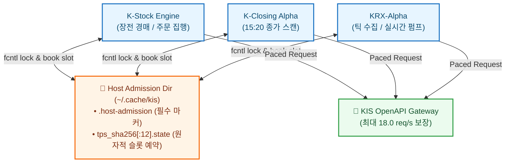

# Korea Investment & Securities (KIS) Integration Specification

> **AI Agent & Operational Technical Reference:**  
> Machine-readable architectural specification of Korea Investment & Securities (한국투자증권) OpenAPI integration for K-Stock Engine. Covers token caching, host-wide admission pacing, pre-open auction capture, and live/paper order execution.

---

## 1. System & Authentication Overview

### 1.1 Base Endpoints
* **Live Base URL:** `https://openapi.koreainvestment.com:9443`
* **Paper (Virtual) Base URL:** `https://openapivts.koreainvestment.com:29443`
* **WebSocket Live:** `ws://ops.koreainvestment.com:21000` (선택적)

### 1.2 OAuth2 Token Lifecycle (`POST /oauth2/tokenP`)
* **Endpoint:** `POST /oauth2/tokenP`
* **Payload:**
  ```json
  {
    "grant_type": "client_credentials",
    "appkey": "<KIS_APP_KEY>",
    "appsecret": "<KIS_APP_SECRET>"
  }
  ```
* **Response Contract:**
  ```json
  {
    "access_token": "eyJhbGciOi...",
    "token_type": "Bearer",
    "expires_in": 86400,
    "access_token_token_expired": "2026-10-16 08:30:00"
  }
  ```
* **Storage & Lock:**
  - 유효기간 24시간(`86400s`).
  - `SharedTokenStore`(`src.integrations.kis.admission`)에 의해 `token_<sha256(app_key)[:12]>.json`으로 디스크에 캐싱.
  - 다중 프로세스/컨테이너 간 중복 발급을 방지하기 위해 `fcntl` 파일 락(`TOKEN_LOCK_TIMEOUT_SECONDS = 240.0s`)을 획득한 후 발급하며, 임시 파일 원자적 교체(`os.replace`) 및 `0600` 권한을 강제.
  - 만료 잔여 시간이 10분 미만이거나 `EGW00121`/`EGW00123` 발생 시 자동 재발급.

---

## 2. Host-Wide Admission Pacing (`HostPacedLimiter`)

동일 호스트(VPS/워크스테이션)에서 `k-stock-engine`, `k-closing-alpha`, `krx-alpha`가 동일한 KIS 계정/AppKey를 공유할 때 발생하는 18.0 req/s 초과 및 IP/계정 차단을 방지하기 위한 공유 원장 메커니즘입니다.



### 2.1 Admission Classes & Booking Lead
`src.integrations.kis.admission.AdmissionClass`:
1. **`CRITICAL` (주문 집행)**:
   - `max_lead = None` (예약 리드 무제한, 도착 즉시 최우선 슬롯 배정).
   - 실계좌 매도/매수 주문(`TTTC0802U`)에 적용.
2. **`STANDARD` (장전 경매 및 스냅샷 수집)**:
   - `max_lead = 1.0s` (최대 1초 이내 가용 슬롯에서만 호출, 1초 초과 시 대기).
3. **`BULK` (대량 배치 수집)**:
   - `max_lead = 0.25s` (대기 지연이 발생하면 크리티컬 작업에 슬롯 양보).

### 2.2 Fail-Closed Safety Rule
* 공유 캐시 디렉터리에 `.host-admission` 마커 파일이 존재하지 않을 경우 `AdmissionDirNotSharedError`를 발생시키며 즉시 실행을 중단합니다. (고립된 환경에서 단독으로 쿼터를 소진하여 타 서비스를 방해하는 사고 방지).

---

## 3. Supported Transaction Records (TR Code Reference)

| TR Code | 서비스명 | 호출 용도 | 입출력 규격 요약 |
| :--- | :--- | :--- | :--- |
| **`FHKST01010100`** | 국내주식 시세 | 현재가 및 체결 기본 정보 | Input: `fid_cond_mrkt_div_code=J`, `fid_input_iscd=<symbol>` |
| **`FHKST01010200`** | 국내주식 호가/예상체결 | 10단계 호가 잔량 및 시초가 경매 예상체결가/수량 | Input: `fid_cond_mrkt_div_code=J`, Output: `antc_cnpr`, `antc_cntg_vrss`, `askp1~10` |
| **`FHKST01010900`** | 투자자별 일별 순매수 | 당일 및 과거 일자별 외인/기관 순매수 수급 | Output: 개인, 외국인, 기관합계 순매수 금액/수량 |
| **`TTTC0802U`** | 주식 현금 매수 주문 | 실계좌 현금 매수 집행 | Headers: `tr_id=TTTC0802U` (실전) / `VTTC0802U` (모의) |
| **`TTTC0801U`** | 주식 현금 매도 주문 | 실계좌 현금 매도 집행 | Headers: `tr_id=TTTC0801U` (실전) / `VTTC0801U` (모의) |
| **`TTTC8434R`** | 주식 잔고 및 예수금 | 실계좌 보유 주식 및 D+2 예수금 조회 | Input: 계좌번호(`CANO`), 비밀번호(`ACNT_PRDT_CD`) |

---

## 4. Pre-Open Auction Capture (`auction-open`)

K-Stock Engine은 매 영업일 **08:39:30 KST**에 장전 시초가 예상 체결 스냅샷을 수집합니다 (`kse-auction-open.service`).

* **Target Universe**: 당일 유효 포트폴리오 후보군 상위 N종목 (기본 80종목).
* **Target TR**: `FHKST01010200` (10호가 및 `output2` 예상 체결 필드).
* **Captured Fields**:
  - `antc_cnpr`: 시초가 단일가 예상 체결가
  - `antc_cntg_qty`: 예상 체결 수량
  - `antc_cntg_vrss`: 전일 대비 예상 변동
  - 10단계 매도/매수 잔량 (`askp1~10`, `bidp1~10`, `askp_rsqn1~10`, `bidp_rsqn1~10`)
* **Storage Location**: `data/bronze/kis/auction_open/dt=YYYY-MM-DD/HHMMSS.jsonl`
* **Dependency Requirement**: 반드시 당일 아침 결정 봉인(`kse-morning.service`, 08:32 KST)이 성공하여 유효 체인이 형성된 이후에만 기동.
