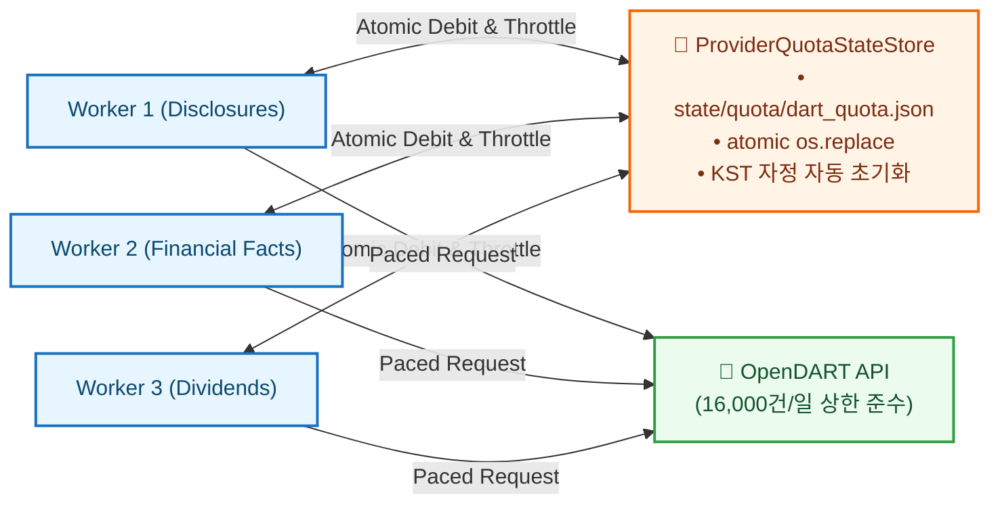

# OpenDART Financial Disclosures Integration Specification

> **AI Agent & Operational Technical Reference:**  
> Machine-readable architectural specification of OpenDART (금융감독원 전자공시시스템) REST API integration for K-Stock Engine. Covers quota budget ledgers, 5.0 req/s rate throttling, Point-in-Time (PIT) financial statement normalization, and I003 market actions ingestion.

---

## 1. System & Authentication Overview

### 1.1 Base Endpoint
* **Base URL:** `https://opendart.fss.or.kr/api`
* **Authentication:** URL 쿼리 파라미터 `crtfc_key=<DART_API_KEY>`

### 1.2 Rate Limit & Quota Constraints
* **Daily Quota Budget:** 공식 1일 20,000건 제공. 엔진은 안전 마진을 적용하여 **1일 16,000건 안전 상한**을 보수적으로 강제.
* **Throttle Rate:** 초당 5건 안전 속도 (`min_interval = 0.20s`).
* **IP Protection:** 실측상 지속 20~30 rps 이상 유입 시 공인 IP 단위로 즉시 차단되므로, 스레드 풀 및 비동기 워커 전역에서 `ProviderQuotaStateStore`에 의해 요청이 엄격히 직렬 페이싱됨.

---

## 2. Quota State Store Architecture (`ProviderQuotaStateStore`)

DART 쿼터는 단일 프로세스가 아닌 다중 수집 워커 간에 안전하게 공유되어야 하며, 장애 재기동 시에도 잔여량이 영속되어야 합니다.

* **원자적 상태 갱신**: 임시 파일 작성 후 `os.replace`로 교체하여 파일 손상 및 동시성 쓰기 경합 방지.
* **자정 리셋**: KST 00:00:00 도달 시 잔여 쿼터 카운터가 자동으로 16,000으로 리셋.

---

## 3. Supported Endpoints & Ingestion Pipeline

| Endpoint | 서비스명 | 엔진 수집 명령 (`src.data.cli`) | 산출 데이터셋 및 불변식 |
| :--- | :--- | :--- | :--- |
| **`/corpCode.xml`** | 고유번호 목록 | `collect-dart-corp-codes` | 상장사 단축코드와 DART 8자리 고유번호(`corp_code`) 매핑 마스터 |
| **`/list.json`** | 공시검색 | `collect-dart-disclosures` | 당일 접수된 전체 공시 목록 (실제 접수시각 `rcept_dt` 타임스탬프 보존) |
| **`/fnlttSinglAcntAll.json`** | 단일회사 전체 재무제표 | `collect-dart-facts` | 재무상태표, 손익계산서, 자본변동표, 현금흐름표 전 계정과목 |
| **`/alotMatter.json`** | 배당에 관한 사항 | `collect-dividend-decisions` | 주당 배당금, 배당기준일, 배당성향 정규화 |
| **`/list.json` (`I003`)** | 거래소 시장조치/안내 | `build-market-actions` | 관리종목, 상장폐지, 매매정지 공시 (ADR-007) |

---

## 4. Point-in-Time (PIT) Normalization Contract

1. **Information Leakage Barrier (45일 미래 편향 차단)**:
   - 1분기(3월 31일 기준) 실적은 통상 5월 15일 전후에 공시됩니다.
   - K-Stock Engine은 결산 기준일이 아닌 DART 공시 시스템에 실제 접수된 시각(`rcept_dt` 및 시간 단위 타임스탬프)을 `available_at`으로 기록합니다.
   - 백테스트 및 리서치 엔진은 `AsOfTable`의 이진 탐색(`bisect_right`)을 통해서만 데이터를 소비하므로, 5월 15일 이전 백테스트 시점에서는 1분기 실적에 절대 접근할 수 없습니다.
2. **Restatement Handling (정정 공시 이력 추적)**:
   - 회사가 과거 분기 실적을 정정 공시하는 경우, 과거 시점의 원래 숫자를 덮어쓰지 않고 새로운 수리 시각을 가진 독립 레코드로 추가 적재(Append-only)합니다.
