# KRX KIND Disclosures Relay Integration Specification

> **AI Agent & Operational Technical Reference:**  
> Machine-readable architectural specification of Korea Exchange Corporate Disclosure Channel (KRX KIND, 상장공시시스템) relay integration for K-Stock Engine. Covers the relay bundle pipeline, importer inbox delivery, and KOSPI market action supplements.

---

## 1. System Motivation & Architectural Role

### 1.1 The KOSPI Disclosure Gap
OpenDART(`I003` 채널)는 KOSDAQ 시장조치는 높은 정확도로 전달하지만, KOSPI 시장의 거래소 통지 일부(상장폐지결정, 정리매매 개시, 관리종목 지정/해제)가 누락되거나 지연 등록되는 한계가 실측되었습니다 (ADR-008).

### 1.2 KIND as Secondary Ground Truth
* **채택 목적**: OpenDART에서 누락되는 KOSPI 거래소 시장조치를 보조 원천으로 실시간 수집하여, 유니버스 필터링 및 상장폐지 전 유령 매수를 원천 차단.
* **수집 대상 양식**:
  - `상장폐지`: 단축코드, 정리매매 기간, 상장폐지일.
  - `관리종목 지정/해제`: 종목명, 단축코드, 지정일/해제일.
  - `매매거래정지/해제`: 정지 사유, 정지 일시.

---

## 2. Relay Pipeline & Importer Inbox Topology

KIND 웹 엔드포인트는 비공식 스크래핑 인터페이스이므로 변경 위험이 있습니다. K-Stock Engine은 메인 엔진의 런타임 안정성을 위해 **릴레이 번들 수집기(`kind_relay_producer`)**를 통해 격리 수집하고, 검증된 canonical JSON 번들(`schema=kind-relay-v1`)만을 **임포터 인박스(`<state_root>/kind_relay/inbox/bundle.json`, `relay_inbox_path`)**로 전달합니다.

**Import cadence**: `kse-morning`(08:32 KST)이 `market_actions` 빌드 직전에 인박스 번들을 파일 전용으로 import하고, `kse-collect-eve`(18:30 KST)가 동일 스텝을 다시 수행합니다. 저녁 재-import는 같은 번들이면 멱등(변경 페이로드 0건, Bronze 쓰기·watermark 무변)이고, 아침 실행 이후 도착한 더 새로운 번들은 같은 저녁에 반영됩니다.

```mermaid
flowchart LR
    classDef kind fill:#f1f3f5,stroke:#495057,stroke-width:1px,color:#212529;
    classDef relay fill:#e7f5ff,stroke:#1971c2,stroke-width:2px,color:#0c4a6e;
    classDef engine fill:#fff4e6,stroke:#f76707,stroke-width:2px,color:#7c2d12;

    KIND_WEB["🌐 KRX KIND Web<br/>(kind.krx.co.kr)"]:::kind
    PRODUCER["🤖 KIND Relay Producer<br/>(1.0 req/s Paced Scraper)"]:::relay
    BUNDLE["📦 Canonical JSON Bundle<br/>(kind-relay-v1 + items_sha256)"]:::relay
    INBOX["📥 Importer Inbox<br/>(&lt;state_root&gt;/kind_relay/inbox/bundle.json)"]:::engine
    SILVER["⚙️ Silver Normalizer<br/>(build-market-actions)"]:::engine

    KIND_WEB -->|HTML Scrape @ 1 req/s| PRODUCER
    PRODUCER -->|Assemble & Validate| BUNDLE
    BUNDLE -->|Atomic Delivery| INBOX
    INBOX -->|Strict Parse & Verify| SILVER
```

---

## 3. Pacing & Fail-Closed Operating Rules

1. **Conservative Pacing (초당 1건 상한)**:
   - KIND 웹서버 부하 및 차단을 방지하기 위해 최소 1.0초 이상의 안전 지연을 강제.
2. **Fail-Closed on Layout Drift (화면 변경 시 즉각 차단)**:
   - 웹 화면의 HTML 테이블 구조나 필수 필드(`단축코드`, `게시일시`) 파싱 실패 시, 휴리스틱 임의 추론을 일절 금지하고 즉시 에러를 발생시키며 수집을 정지(Fail-Closed).
3. **KOSDAQ 해제 플래그 우선 규칙 (ADR-008 Operating Rule)**:
   - KOSDAQ 종목의 KIND `관리종목 해제`는 무시하고 KRX 일별 시세의 `SECT_TP_NM` 플래그 전이만을 정본으로 채택. (KIND 해제 통지의 28%가 사유별 부분 해제여서 실제 소속부 플래그와 불일치했던 실측 반영).
   - KOSPI 종목은 소속부 플래그가 없으므로 KIND 통지를 그대로 신뢰.
